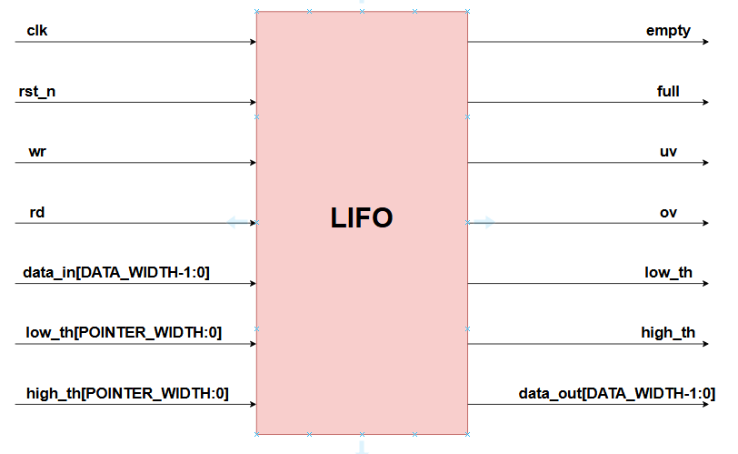
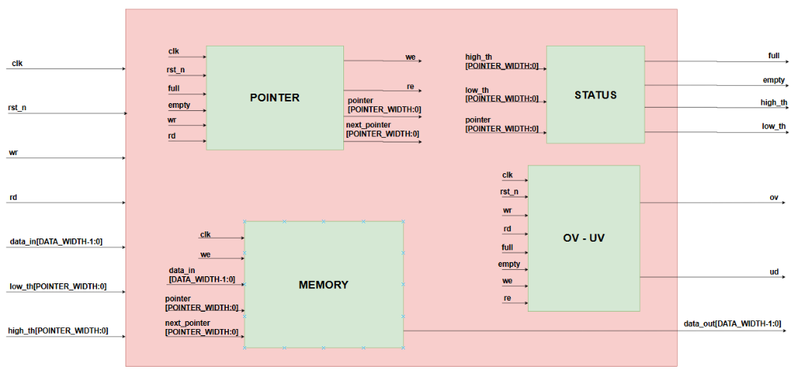
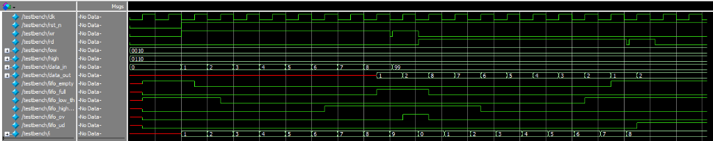

# 📚 Parametric LIFO Buffer (Hardware Stack IP)

[](https://en.wikipedia.org/wiki/Verilog)
[]()
[]()

> **Tác giả (Author)**: Lê Anh Khoa ([@KhoaLe246205](https://github.com/KhoaLe246205))  
> **Trọng tâm thiết kế**: Thiết kế bộ đệm phần cứng hoạt động theo cơ chế **LIFO (Last-In, First-Out / Ngăn xếp phần cứng)** có khả năng tham số hóa toàn diện, tối ưu hóa bộ cộng con trỏ bằng phép bù 2, hỗ trợ ngưỡng cảnh báo động (Programmable Thresholds) và cơ chế bảo vệ chống ghi tràn / đọc cạn (Overflow / Underflow Protection).

---

## 📑 Mục Lục (Table of Contents)
1. [Tổng Quan & Đặc Điểm Nổi Bật (Overview & Key Features)](#1-tổng-quan--đặc-điểm-nổi-bật-overview--key-features)
2. [Kiến Trúc Phần Cứng & Sơ Đồ Khối (Hardware Architecture)](#2-kiến-trúc-phần-cứng--sơ-đồ-khối-hardware-architecture)
   - [2.1. Biểu Tượng Khối Mức Đỉnh (Top-Level Block Symbol)](#21-biểu-tượng-khối-mức-đỉnh-top-level-block-symbol)
   - [2.2. Sơ Đồ Vi Kiến Trúc Tích Hợp (Internal Block Architecture)](#22-sơ-đồ-vi-kiến-trúc-tích-hợp-internal-block-architecture)
3. [Đặc Tả Giao Tiếp Mức Đỉnh (Top-Level Interface)](#3-đặc-tả-giao-tiếp-mức-đỉnh-top-level-interface)
4. [Phân Tích Chi Tiết Các Khối RTL (Submodule Deep-Dive)](#4-phân-tích-chi-tiết-các-khối-rtl-submodule-deep-dive)
5. [Kết Quả Kiểm Chứng & Giải Thích Waveform (Verification & Waveform Analysis)](#5-kết-quả-kiểm-chứng--giải-thích-waveform-verification--waveform-analysis)
6. [Cấu Trúc Thư Mục & Tài Liệu (Directory Structure)](#6-cấu-trúc-thư-mục--tài-liệu-directory-structure)

---

## 1. Tổng Quan & Đặc Điểm Nổi Bật (Overview & Key Features)

Khối **LIFO Buffer** là thành phần lưu trữ cốt lõi trong các bộ vi xử lý (quản lý Call Stack, lưu ngữ cảnh ngắt), bộ xử lý biểu thức hậu tố và các bộ đệm truyền thông tốc độ cao.

* **Tham số hóa linh hoạt (Fully Parameterized)**:
  * `DATA_WIDTH` (Mặc định: `16` bit): Độ rộng từ dữ liệu.
  * `POINTER_WIDTH` (Mặc định: `4` bit): Định nghĩa độ sâu của ngăn xếp `DATA_NUM` $= 2^{W}$ ô nhớ (với $W =$ `POINTER_WIDTH`).
* **Tối ưu diện tích với Bộ Cộng Đơn (Single-Adder Pointer Logic)**:
  * Thay vì dùng 1 bộ cộng (`+1`) và 1 bộ trừ (`-1`) riêng biệt, mạch sử dụng phép cộng bù 2 để gộp cả hai thao tác Push (Ghi) và Pop (Đọc) vào duy nhất một bộ cộng phần cứng.
* **Cờ trạng thái và ngưỡng linh hoạt (Dynamic Status & Threshold Flags)**:
  * Phát hiện tức thì trạng thái Đầy (`lifo_full`), Rỗng (`lifo_empty`), dưới ngưỡng thấp (`lifo_low_th`) và vượt ngưỡng cao (`lifo_high_th`) thông qua hai cổng ngưỡng động `low` và `high`.
* **Bảo vệ toàn vẹn dữ liệu (Data Integrity & Error Tracking)**:
  * Tự động khóa thao tác ghi khi đầy (`lifo_we = wr & ~lifo_full`) và khóa thao tác đọc khi rỗng (`lifo_re = rd & ~lifo_empty`), đồng thời bật cờ báo lỗi `lifo_ov` (Overflow) và `lifo_ud` (Underflow).

---

## 2. Kiến Trúc Phần Cứng & Sơ Đồ Khối (Hardware Architecture)

### 2.1. Biểu Tượng Khối Mức Đỉnh (Top-Level Block Symbol)

<p align="center">
  
  <br>
  <em>Hình 1: Sơ đồ khối giao diện vào/ra mức đỉnh của bộ đệm LIFO</em>
</p>

### 2.2. Sơ Đồ Vi Kiến Trúc Tích Hợp (Internal Block Architecture)

Hệ thống được phân rã thành 4 khối chức năng độc lập (`POINTER`, `STATUS`, `MEMORY`, `OV - UV`) kết nối bên trong module mức đỉnh [`rtl/top.v`](rtl/top.v):

<p align="center">
  
  <br>
  <em>Hình 2: Sơ đồ cấu trúc bên trong kết nối các khối POINTER, STATUS, MEMORY và OV-UV</em>
</p>

---

## 3. Đặc Tả Giao Tiếp Mức Đỉnh (Top-Level Interface)

### Tham số cấu hình (Parameters)
| Tên Tham Số | Giá Trị Mặc Định | Mô Tả |
| :--- | :---: | :--- |
| `DATA_WIDTH` | `16` | Độ rộng bus dữ liệu vào/ra (`data_in`, `data_out`). |
| `POINTER_WIDTH` | `4` | Số bit địa chỉ ô nhớ (Độ sâu ngăn xếp $= 2^4 = 16$ phần tử). |

### Bảng tín hiệu cổng (Port Signals)
| Tên Cổng | Độ Rộng | Hướng | Mô Tả Chức Năng |
| :--- | :---: | :---: | :--- |
| `clk` | 1 bit | Input | Xung nhịp đồng bộ hệ thống (kích hoạt sườn dương `posedge`). |
| `rst_n` | 1 bit | Input | Tín hiệu Reset đồng bộ tích cực mức thấp (`0`: Reset hệ thống). |
| `wr` | 1 bit | Input | Yêu cầu đẩy dữ liệu vào ngăn xếp (**Push / Write**). |
| `rd` | 1 bit | Input | Yêu cầu lấy dữ liệu khỏi đỉnh ngăn xếp (**Pop / Read**). |
| `low` | `POINTER_WIDTH+1` | Input | Ngưỡng cảnh báo số lượng phần tử thấp (Low Watermark Threshold). |
| `high` | `POINTER_WIDTH+1` | Input | Ngưỡng cảnh báo số lượng phần tử cao (High Watermark Threshold). |
| `data_in` | `DATA_WIDTH` | Input | Dữ liệu đầu vào cần ghi vào đỉnh ngăn xếp. |
| `data_out` | `DATA_WIDTH` | Output | Dữ liệu đọc ra từ đỉnh ngăn xếp. |
| `lifo_empty` | 1 bit | Output | Cờ báo ngăn xếp đang rỗng hoàn toàn (`pointer == 0`). |
| `lifo_full` | 1 bit | Output | Cờ báo ngăn xếp đã đầy hoàn toàn (`pointer == 2^POINTER_WIDTH`). |
| `lifo_low_th` | 1 bit | Output | Cờ báo số lượng phần tử hiện tại nhỏ hơn ngưỡng `low` (`pointer < low`). |
| `lifo_high_th`| 1 bit | Output | Cờ báo số lượng phần tử hiện tại đạt hoặc vượt ngưỡng `high` (`pointer >= high`). |
| `lifo_ov` | 1 bit | Output | Cờ báo lỗi tràn ngăn xếp (**Overflow**: cố ghi khi `lifo_full = 1`). |
| `lifo_ud` | 1 bit | Output | Cờ báo lỗi cạn ngăn xếp (**Underflow**: cố đọc khi `lifo_empty = 1`). |

---

## 4. Phân Tích Chi Tiết Các Khối RTL (Submodule Deep-Dive)

### 4.1. Khối Điều Khiển Con Trỏ (`rtl/pointer.v`)
* **Độ rộng con trỏ**: Sử dụng thanh ghi `pointer` có độ rộng `POINTER_WIDTH + 1` bit để phân biệt rõ ràng giữa trạng thái Rỗng (`00000`) và Đầy (`10000`).
* **Bảo vệ ghi/đọc**:
  ```verilog
  assign lifo_we = wr & ~lifo_full;
  assign lifo_re = rd & ~lifo_empty;
  assign lifo_en = lifo_re ^ lifo_we;
  ```
  Nhờ phép XOR (`^`), nếu hệ thống không nhận lệnh hoặc nhận đồng thời cả lệnh đọc và ghi hợp lệ, `lifo_en = 0` giúp giữ nguyên vị trí con trỏ.
* **Kỹ thuật tối ưu bộ cộng bù 2 (Two's Complement Shared Adder)**:
  ```verilog
  assign add_value    = lifo_re ? {{POINTER_WIDTH{1'b1}}, 1'b0} : {(POINTER_WIDTH+1){1'b0}};
  assign next_pointer = pointer + add_value + 1'b1;
  ```
  * Khi **Ghi (`lifo_we = 1, lifo_re = 0`)**: `add_value = 0`, do đó `next_pointer = pointer + 0 + 1 = pointer + 1` (Tăng 1).
  * Khi **Đọc (`lifo_re = 1`)**: `add_value = 11...10` (tức $-2$ trong hệ bù 2), do đó `next_pointer = pointer + (-2) + 1 = pointer - 1` (Giảm 1).

### 4.2. Khối Trạng Thái & So Sánh Ngưỡng (`rtl/status.v`)
* Thiết kế tổ hợp thuần túy không tạo trễ chu kỳ:
  * **Báo đầy (`lifo_full`)**: Chỉ cần kiểm tra bit trọng số lớn nhất `pointer[POINTER_WIDTH]`.
  * **Báo rỗng (`lifo_empty`)**: Dùng cổng NOR thu gọn `~|pointer`.
  * **Báo ngưỡng động**: So sánh trực tiếp `pointer < low` và `pointer >= high`.

### 4.3. Khối Phát Hiện Lỗi Tràn / Cạn (`rtl/ov-uv.v`)
* Quản lý hai thanh ghi cờ lỗi kiểu chốt giữ trạng thái (Sticky Flags):
  * `lifo_ov`: Bật lên `1` khi có lệnh `wr` lúc `lifo_full = 1`. Tự động xóa về `0` ngay khi có một thao tác đọc hợp lệ (`lifo_re = 1`).
  * `lifo_ud`: Bật lên `1` khi có lệnh `rd` lúc `lifo_empty = 1`. Tự động xóa về `0` ngay khi có một thao tác ghi hợp lệ (`lifo_we = 1`).

### 4.4. Khối Mảng Bộ Nhớ Đồng Bộ (`rtl/memory.v`)
* Tổ chức mảng thanh ghi `reg [DATA_WIDTH-1:0] mem_array [DATA_NUM-1:0]`.
* Ghi dữ liệu `data_in` đồng bộ theo sườn lên `clk` tại địa chỉ `pointer[POINTER_WIDTH-1:0]` khi `lifo_we = 1`.
* Xuất dữ liệu đọc `data_out` theo địa chỉ `next_pointer[POINTER_WIDTH-1:0]`, đảm bảo phần tử vừa nạp vào cuối cùng sẽ được lấy ra đầu tiên (đúng chuẩn LIFO).

---

## 5. Kết Quả Kiểm Chứng & Giải Thích Waveform (Verification & Waveform Analysis)

File [`tb/testbench.v`](tb/testbench.v) kiểm chứng toàn diện hệ thống với cấu hình `DATA_WIDTH = 8`, `POINTER_WIDTH = 3` (Độ sâu $2^3 = 8$ phần tử, ngưỡng thấp `low = 2`, ngưỡng cao `high = 6`):

<p align="center">
  
  <br>
  <em>Hình 3: Kết quả mô phỏng dạng sóng kiểm chứng đầy đủ các chế độ Push, Overflow, Pop và Underflow trên ModelSim</em>
</p>

### 5.1. Giải thích diễn biến theo từng mốc thời gian trên Waveform

1. **Giai đoạn 0 — Khởi tạo & Reset (`rst_n = 0`)**:
   * Ở 2 chu kỳ xung nhịp đầu tiên, `rst_n = 0` đưa con trỏ `pointer` về `0`.
   * Cờ `lifo_empty = 1` (ngăn xếp rỗng) và `lifo_low_th = 1` (do $0 < \text{low} = 2$).
2. **Giai đoạn 1 — Push liên tiếp 8 phần tử (`i = 1` $\rightarrow$ `8`, `wr = 1`)**:
   * Tại mỗi sườn lên của `clk`, các giá trị `data_in` từ **`1, 2, 3, 4, 5, 6, 7, 8`** lần lượt được ghi vào `mem_array[0..7]`.
   * Ngay sau khi ghi số `1` (`pointer = 1`): `lifo_empty` hạ từ `1` xuống `0`.
   * Ngay sau khi ghi số `2` (`pointer = 2`): Số lượng phần tử đạt ngưỡng `low = 2` nên `lifo_low_th` hạ từ `1` xuống `0`.
   * Ngay sau khi ghi số `6` (`pointer = 6`): Số lượng phần tử chạm ngưỡng `high = 6` nên `lifo_high_th` bật từ `0` lên `1`.
   * Ngay sau khi ghi số `8` (`pointer = 8`): Ngăn xếp đầy hoàn toàn nên `lifo_full` bật từ `0` lên `1`.
3. **Giai đoạn 2 — Kiểm tra chống Ghi Tràn / Overflow (`data_in = 99`, `wr = 1`)**:
   * Khi `lifo_full = 1`, Testbench cố tình đẩy thêm giá trị `99` với `wr = 1`.
   * Mạch bảo vệ khóa tín hiệu ghi nội bộ (`lifo_we = wr & ~lifo_full = 0`), ngăn không cho `99` ghi đè vào bộ nhớ, đồng thời bật cờ báo lỗi **`lifo_ov = 1`**.
4. **Giai đoạn 3 — Pop liên tiếp 8 phần tử (`i = 0` $\rightarrow$ `7`, `rd = 1`)**:
   * Khi `wr = 0` và `rd = 1`, ngăn xếp xuất dữ liệu ra trên `data_out` theo đúng thứ tự ngược lại (**Vào Sau - Ra Trước**): **`8` $\rightarrow$ `7` $\rightarrow$ `6` $\rightarrow$ `5` $\rightarrow$ `4` $\rightarrow$ `3` $\rightarrow$ `2` $\rightarrow$ `1`**.
   * Ngay ở nhịp đọc đầu tiên (`data_out = 8`), cờ `lifo_full` hạ về `0` và cờ lỗi `lifo_ov` tự động được xóa về `0`.
   * Khi số phần tử giảm xuống $5$ (`< 6`), `lifo_high_th` hạ xuống `0`. Khi giảm xuống $1$ (`< 2`), `lifo_low_th` bật lại lên `1`.
   * Sau khi đọc xong phần tử cuối cùng là `1` (`pointer = 0`), cờ **`lifo_empty` bật lên `1`**.
5. **Giai đoạn 4 — Kiểm tra chống Đọc Cạn / Underflow (`rd = 1` khi `lifo_empty = 1`)**:
   * Testbench kích thêm 1 xung `rd = 1` khi ngăn xếp đã rỗng. Mạch khóa tín hiệu đọc nội bộ (`lifo_re = 0`) và bật cờ báo lỗi **`lifo_ud = 1`**.

---

### 5.2. Phân tích thiết kế phần cứng: Tại sao trên Waveform `data_out` xuất hiện `X`, `1`, `2` trước khi bật `rd = 1`?

Trong module [`rtl/memory.v`](rtl/memory.v), thanh ghi đầu ra `data_out` được thiết kế theo cấu trúc **Non-Gated Look-Ahead Output Register**:
```verilog
always @(posedge clk) begin
    data_out <= mem_array[next_pointer[POINTER_WIDTH-1:0]];
end
```
* **Nguyên nhân xuất hiện trên Waveform**:
  1. Trong lúc đang Ghi `1..7` (`rd = 0`), `lifo_re = 0` nên `next_pointer = pointer + 1` luôn trỏ trước vào ô nhớ kế tiếp chưa được ghi dữ liệu $\rightarrow$ mô phỏng hiển thị đường màu đỏ (`X` - Uninitialized).
  2. Khi vừa ghi xong phần tử thứ 8 (`pointer = 4'b1000`), 3 bit địa chỉ thấp `next_pointer[2:0]` quay vòng (wrap-around) về `3'b000` (ô nhớ 0 đang chứa số `1`) và ở chu kỳ kế tiếp là `3'b001` (ô nhớ 1 đang chứa số `2`), nên `data_out` xuất hiện giá trị `1` và `2` trước khi lệnh `rd = 1` bắt đầu.
* **Lý do lựa chọn trong thiết kế vi mạch (Hardware Trade-off)**:
  * **Tiết kiệm diện tích logic (Area Optimization)**: Không sử dụng tín hiệu `lifo_re` làm chân Clock-Enable cho thanh ghi `data_out` giúp loại bỏ hoàn toàn bộ MUX 2-sang-1 phản hồi (Feedback Multiplexer) có độ rộng `DATA_WIDTH` bit trước các D-Flip-Flop đầu ra, đúng theo sơ đồ kiến trúc chuẩn của khối bộ nhớ đồng bộ.
  * **Quy ước giao thức Bus chuẩn (Valid-Data Sampling Protocol)**: Trong hệ thống số đồng bộ, khối Master phía sau chỉ lấy mẫu (sample) giá trị trên bus `data_out` tại các chu kỳ có lệnh đọc hợp lệ (`rd = 1` và `lifo_empty = 0`). Tại các chu kỳ không thực hiện lệnh đọc (`rd = 0`), trạng thái trên bus `data_out` là *"Don't Care"* và không ảnh hưởng tới tính đúng đắn của toàn hệ thống.

### Lệnh chạy mô phỏng trên ModelSim / QuestaSim:
```bash
cd 01_LIFO_Buffer
vlib work
vlog rtl/*.v tb/testbench.v
vsim -c -do "run -all; quit" work.testbench
```

---

## 6. Cấu Trúc Thư Mục & Tài Liệu (Directory Structure)

```text
01_LIFO_Buffer/
├── images/
│   ├── lifo_top_symbol.png    # Biểu tượng khối mức đỉnh LIFO
│   ├── lifo_architecture.png  # Sơ đồ kiến trúc nội bộ kết nối 4 khối con
│   └── lifo_waveform.png      # Kết quả mô phỏng dạng sóng trên ModelSim
├── docs/
│   ├── LIFO.drawio            # Sơ đồ kiến trúc vi mạch thiết kế trên Draw.io
│   ├── LIFO.pdf               # Báo cáo đặc tả kỹ thuật chi tiết (Tiếng Việt)
│   ├── LIFO_ENGver.pdf        # Báo cáo đặc tả kỹ thuật chi tiết (Tiếng Anh)
│   └── LIFO.pptx              # Slide thuyết trình kiến trúc và kết quả mô phỏng
├── rtl/
│   ├── top.v                  # Module mức đỉnh kết nối toàn hệ thống LIFO
│   ├── pointer.v              # Khối quản lý con trỏ đọc/ghi dùng bộ cộng bù 2
│   ├── status.v               # Khối giải mã cờ trạng thái và ngưỡng cảnh báo
│   ├── ov-uv.v                # Khối phát hiện lỗi Overflow và Underflow
│   └── memory.v               # Mảng bộ nhớ lưu trữ đồng bộ
├── tb/
│   └── testbench.v            # Testbench tự động kiểm tra toàn diện (Self-checking)
└── README.md                  # Tài liệu kỹ thuật của dự án LIFO Buffer
```
