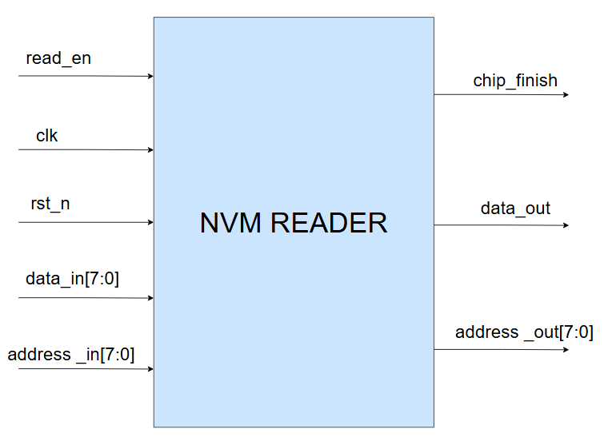
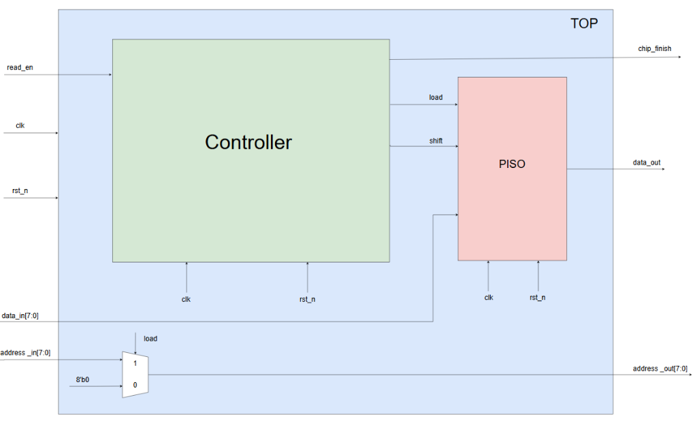
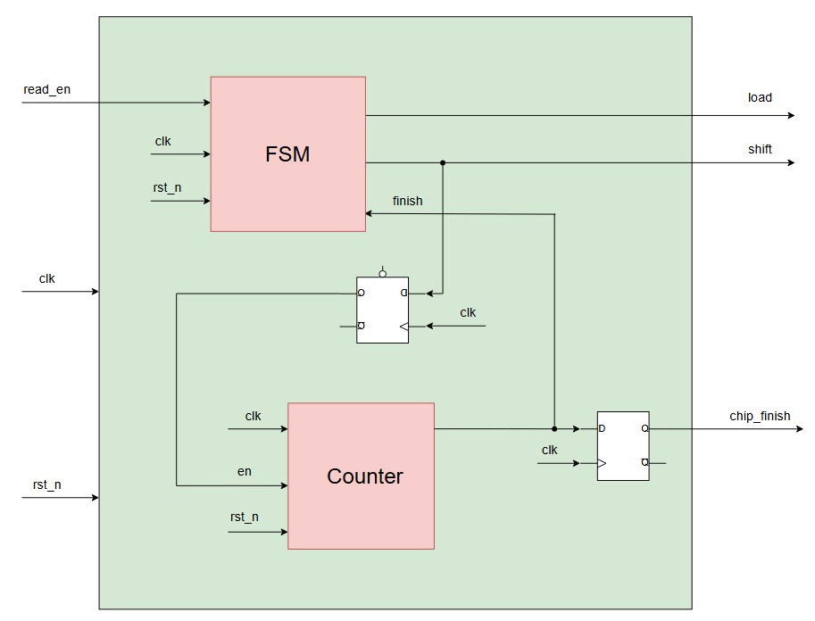
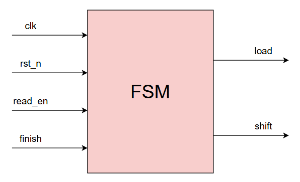
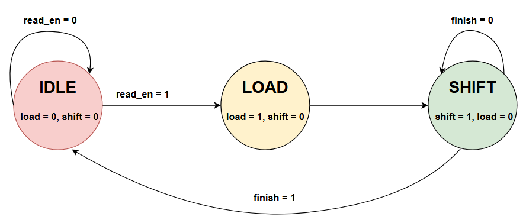
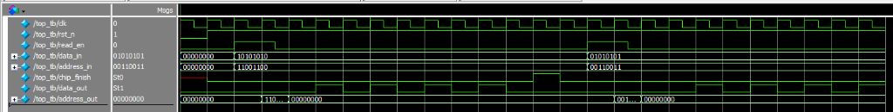

# 💾 Non-Volatile Memory (NVM) Serial Reader Controller

[](https://en.wikipedia.org/wiki/Verilog)
[]()
[]()

> **Tác giả (Author)**: Lê Anh Khoa ([@KhoaLe246205](https://github.com/KhoaLe246205))  
> **Trọng tâm thiết kế**: Thiết kế bộ điều khiển đọc dữ liệu từ bộ nhớ bất biến (**Non-Volatile Memory - NVM / Flash / OTP / EEPROM**), thực hiện chốt địa chỉ truy xuất tự động (Address Gating), nạp dữ liệu song song 8-bit và chuyển đổi sang luồng bit nối tiếp (Serial Stream) thông qua máy trạng thái hữu hạn Moore (FSM), bộ đếm chu kỳ bit (Bit Counter) và thanh ghi dịch PISO.

---

## 📑 Mục Lục (Table of Contents)
1. [Tổng Quan Hệ Thống & Bài Toán Kỹ Thuật (System Overview)](#1-tổng-quan-hệ-thống--bài-toán-kỹ-thuật-system-overview)
2. [Đặc Tả Giao Tiếp Mức Đỉnh & Sơ Đồ Khối (Top-Level Interface & Symbol)](#2-đặc-tả-giao-tiếp-mức-đỉnh--sơ-đồ-khối-top-level-interface--symbol)
3. [Kiến Trúc Phần Cứng Phân Tầng (Hierarchical Hardware Architecture)](#3-kiến-trúc-phần-cứng-phân-tầng-hierarchical-hardware-architecture)
   - [3.1. Sơ Đồ Kiến Trúc Mức Đỉnh Toàn Hệ Thống (Top-Level Architecture)](#31-sơ-đồ-kiến-trúc-mức-đỉnh-toàn-hệ-thống-top-level-architecture)
   - [3.2. Vi Kiến Trúc Khối Điều Khiển Trung Tâm (Controller Architecture)](#32-vi-kiến-trúc-khối-điều-khiển-trung-tâm-controller-architecture)
4. [Đặc Tả Máy Trạng Thái FSM & Các Khối Chức Năng (FSM & Submodules)](#4-đặc-tả-máy-trạng-thái-fsm--các-khối-chức-năng-fsm--submodules)
   - [4.1. Biểu Tượng Khối FSM (FSM Block Symbol)](#41-biểu-tượng-khối-fsm-fsm-block-symbol)
   - [4.2. Lưu Đồ Chuyển Trạng Thái (FSM State Transition Diagram)](#42-lưu-đồ-chuyển-trạng-thái-fsm-state-transition-diagram)
   - [4.3. Khối Bộ Đếm Chu Kỳ Dịch (Bit Counter)](#43-khối-bộ-đếm-chu-kỳ-dịch-bit-counter)
   - [4.4. Khối Thanh Ghi Dịch PISO 8-Bit (PISO Shift Register)](#44-khối-thanh-ghi-dịch-piso-8-bit-piso-shift-register)
5. [Kết Quả Kiểm Chứng & Giải Thích Waveform (Verification & Waveform Analysis)](#5-kết-quả-kiểm-chứng--giải-thích-waveform-verification--waveform-analysis)
6. [Cấu Trúc Thư Mục & Tài Liệu (Directory Structure)](#6-cấu-trúc-thư-mục--tài-liệu-directory-structure)

---

## 1. Tổng Quan Hệ Thống & Bài Toán Kỹ Thuật (System Overview)

Trong thiết kế vi mạch số và hệ thống nhúng SoC, dữ liệu khởi tạo (Boot Code), khóa bảo mật phần cứng (Cryptographic Keys) hoặc tham số hiệu chuẩn thường được lưu trữ trong các ô nhớ bất biến (**NVM / Flash / eFuse / EEPROM**) dưới dạng các từ dữ liệu song song 8-bit.

Tuy nhiên, việc kéo một bus dữ liệu song song nhiều bit xuyên qua các phân vùng (domains) của chip thường gặp các hạn chế:
* **Chi phí chân IO và định tuyến (Routing Congestion & Pin Count)**: Kéo bus 8-bit hoặc 16-bit tốn diện tích kim loại (metal routing) và tăng điện dung ký sinh.
* **Tiết kiệm năng lượng & Giảm nhiễu (EMI / Power Optimization)**: Truyền dữ liệu nối tiếp (Serial Streaming) giảm đáng kể số lượng đường dây chuyển mạch đồng thời, hạn chế nhiễu sụt áp nguồn (IR-drop) và nhiễu xuyên âm (Crosstalk).

Hệ thống **NVM Serial Reader Controller** giải quyết triệt để bài toán này với chu trình vận hành khép kín:
> **Quy trình hoạt động (Execution Pipeline)**:  
> **Host Read Request** `(read_en = 1)` $\rightarrow$ **Latch Address & Data** `(LOAD)` $\rightarrow$ **MSB-First Serialization** `(SHIFT - 8 cycles)` $\rightarrow$ **Done Handshake** `(chip_finish = 1)`

---

## 2. Đặc Tả Giao Tiếp Mức Đỉnh & Sơ Đồ Khối (Top-Level Interface & Symbol)

Khối đọc NVM mức đỉnh [`rtl/top.v`](rtl/top.v) cung cấp giao tiếp điều khiển và bus dữ liệu rõ ràng:

<p align="center">
  
  <br>
  <em>Hình 1: Biểu tượng khối mức đỉnh (Top-Level Block Symbol) của NVM Reader Controller</em>
</p>

### Bảng Đặc Tả Tín Hiệu (Pin Description Table)

| Tên Cổng (Port) | Độ Rộng | Hướng | Miêu Tả Chức Năng Chi Tiết (Functional Description) |
| :--- | :---: | :---: | :--- |
| `clk` | 1 bit | Input | Xung nhịp đồng bộ hệ thống (kích hoạt sườn dương `posedge clk`). |
| `rst_n` | 1 bit | Input | Tín hiệu Reset bất đồng bộ tích cực mức thấp (`negedge rst_n`), đưa hệ thống về trạng thái `IDLE`. |
| `read_en` | 1 bit | Input | Xung kích hoạt yêu cầu đọc NVM từ hệ thống Host / Master bên ngoài. |
| `data_in[7:0]` | 8 bit | Input | Bus dữ liệu song song 8-bit đọc từ mảng ô nhớ NVM. |
| `address_in[7:0]` | 8 bit | Input | Bus địa chỉ của ô nhớ cần đọc do Master yêu cầu. |
| `chip_finish` | 1 bit | Output | Xung tích cực mức `1` (độ rộng đúng 1 chu kỳ clock) báo hiệu đã đọc và truyền nối tiếp xong 8 bit. |
| `data_out` | 1 bit | Output | Ngõ ra dữ liệu nối tiếp (Serial Output stream, truyền bit MSB trước). |
| `address_out[7:0]` | 8 bit | Output | Bus địa chỉ phát trực tiếp tới mảng nhớ NVM trong pha `LOAD` (được cổng hóa an toàn). |

---

## 3. Kiến Trúc Phần Cứng Phân Tầng (Hierarchical Hardware Architecture)

### 3.1. Sơ Đồ Kiến Trúc Mức Đỉnh Toàn Hệ Thống (Top-Level Architecture)

Module mức đỉnh [`rtl/top.v`](rtl/top.v) tích hợp khối điều khiển trung tâm (`Controller`), thanh ghi dịch song song sang nối tiếp (`PISO`) và mạch cổng hóa địa chỉ (Address Multiplexer):

<p align="center">
  
  <br>
  <em>Hình 2: Sơ đồ kiến trúc mức đỉnh (TOP) của bộ điều khiển đọc bộ nhớ NVM</em>
</p>

* **Cơ chế cổng hóa địa chỉ (Address Gating Multiplexer)**:
  ```verilog
  assign address_out = (load) ? address_in : 8'b0;
  ```
  Địa chỉ truy xuất `address_in` chỉ được mở ra chân `address_out` trong đúng 1 chu kỳ clock khi FSM ở trạng thái `LOAD` (`load = 1`). Ở tất cả các trạng thái còn lại (`IDLE`, `SHIFT`), `address_out` được triệt tiêu về `8'b00000000`, giúp ngăn ngừa hiện tượng rò rỉ tín hiệu và bảo vệ mảng ô nhớ NVM khỏi các truy xuất không mong muốn.

---

### 3.2. Vi Kiến Trúc Khối Điều Khiển Trung Tâm (Controller Architecture)

Bên trong khối [`rtl/controller.v`](rtl/controller.v), FSM kết hợp chặt chẽ với bộ đếm bit và 2 Flip-Flop trễ để điều phối thời gian chính xác:

<p align="center">
  
  <br>
  <em>Hình 3: Sơ đồ vi kiến trúc bên trong khối Controller kết nối FSM, Counter và các D-Flip-Flop</em>
</p>

* **Đồng bộ hóa nhịp cho phép đếm (`en`)**:
  * Tín hiệu `shift` sinh ra từ tổ hợp trạng thái của FSM được đưa qua một tầng D-Flip-Flop lấy mẫu theo `clk`: `shift_reg <= shift_wire`.
  * Tín hiệu `en = shift_reg` được dùng làm chân cho phép của `Counter`, đảm bảo bộ đếm bắt đầu tăng nhịp một cách đồng bộ hoàn hảo ngay chu kỳ clock đầu tiên của pha dịch.
* **Chốt xung báo hoàn tất (`chip_finish`)**:
  * Khi bộ đếm đạt giá trị kết thúc (`count == 3'b111`), cờ `finish` kích hoạt. Tín hiệu này được đưa qua D-Flip-Flop xuất ra cổng `chip_finish <= finish` với độ rộng đúng 1 chu kỳ xung nhịp để thông báo cho hệ thống Master bên ngoài.

---

## 4. Đặc Tả Máy Trạng Thái FSM & Các Khối Chức Năng (FSM & Submodules)

### 4.1. Biểu Tượng Khối FSM (FSM Block Symbol)

<p align="center">
  
  <br>
  <em>Hình 4: Biểu tượng khối điều khiển trạng thái FSM (Finite State Machine)</em>
</p>

* **Đầu vào (Inputs)**: `clk`, `rst_n`, `read_en`, `finish`.
* **Đầu ra (Outputs)**: `load` (điều khiển nạp song song), `shift` (điều khiển dịch nối tiếp).

---

### 4.2. Lưu Đồ Chuyển Trạng Thái (FSM State Transition Diagram)

FSM được thiết kế theo mô hình **Moore Machine** 3 trạng thái độc lập được mã hóa 2-bit:

<p align="center">
  
  <br>
  <em>Hình 5: Sơ đồ chuyển đổi trạng thái của bộ điều khiển FSM</em>
</p>

#### Bảng Mã Hóa & Hành Vi Trạng Thái:
| Trạng Thái | Mã Hóa | Ngõ Ra (`load`, `shift`) | Điều Kiện Chuyển Tiếp (Transition Conditions) |
| :---: | :---: | :---: | :--- |
| **`IDLE`** | `2'b01` | `load = 0`<br>`shift = 0` | • Nếu `read_en = 0`: Duy trì tại `IDLE`.<br>• Nếu `read_en = 1`: Chuyển sang `LOAD`. |
| **`LOAD`** | `2'b10` | `load = 1`<br>`shift = 0` | • Tự động chuyển sang `SHIFT` sau đúng 1 chu kỳ clock. Trong chu kỳ này, địa chỉ được xuất ra `address_out` và dữ liệu `data_in` được chốt vào PISO. |
| **`SHIFT`**| `2'b11` | `load = 0`<br>`shift = 1` | • Nếu `finish = 0`: Tiếp tục ở lại `SHIFT` để đẩy dữ liệu.<br>• Khi `finish = 1` (đủ 8 chu kỳ): Tự động chuyển về `IDLE`. |

---

### 4.3. Khối Bộ Đếm Chu Kỳ Dịch (`rtl/counter.v`)
* **Chức năng**: Đếm đúng 8 chu kỳ xung nhịp để đồng bộ với thanh ghi dịch 8-bit.
* **Cơ chế**:
  * Khi nhận `en = 1`, thanh ghi `count` tăng dần từ `3'b000` (0) đến `3'b111` (7).
  * Khi đạt giá trị `3'b111`, biểu thức so sánh bật cờ báo hoàn tất:
    ```verilog
    assign finish = (count == 3'b111) ? 1'b1 : 1'b0;
    ```
  * Khi `en = 0` (hệ thống thoát khỏi trạng thái `SHIFT`), bộ đếm tự động reset về `0`.

---

### 4.4. Khối Thanh Ghi Dịch PISO 8-Bit (`rtl/PISO.v`)
* **Cơ chế nạp song song và dịch nối tiếp (Parallel-In Serial-Out)**:
  ```verilog
  always @(posedge clk or negedge rst_n) begin
      if (!rst_n) begin
          data_reg <= 8'b0;
          data_out <= 1'b0;
      end else if (load) 
          data_reg <= data_in;
      else if (shift) begin
          data_out <= data_reg[7];
          data_reg <= {data_reg[6:0], 1'b0};
      end
  end
  ```
  * Trong pha `LOAD`: Chốt toàn bộ byte `data_in` vào thanh ghi `data_reg`.
  * Trong pha `SHIFT`: Bit có trọng số cao nhất (`data_reg[7]`) được đưa ra chân `data_out`, đồng thời toàn bộ thanh ghi dịch trái 1 bit và điền `0` vào vị trí LSB.

---

## 5. Kết Quả Kiểm Chứng & Giải Thích Waveform (Verification & Waveform Analysis)

File testbench [`tb/testbench.v`](tb/testbench.v) thực hiện kiểm tra toàn diện hoạt động của hệ thống qua hai giao dịch đọc tuần tự trên trình mô phỏng **ModelSim ME**:

<p align="center">
  
  <br>
  <em>Hình 6: Dạng sóng mô phỏng ModelSim kiểm chứng 2 chu kỳ đọc liên tiếp với các gói dữ liệu khác nhau</em>
</p>

### Giải thích chi tiết các pha hoạt động trên Waveform:

1. **Khởi tạo hệ thống (`0ns` $\rightarrow$ `10ns`)**:
   * Tín hiệu `rst_n = 0` đưa toàn bộ hệ thống về trạng thái ban đầu (`IDLE`).
   * Các ngõ ra `address_out = 8'b00000000`, `chip_finish = 0`, `data_out = 0`.
2. **Giao dịch Đọc 1 (`t = 20ns` $\rightarrow$ `110ns`)**:
   * **Kích hoạt**: Cấp xung `read_en = 1`, cài đặt địa chỉ `address_in = 8'b11001100` (`0xCC`) và dữ liệu mô phỏng từ NVM `data_in = 8'b10101010` (`0xAA`).
   * **Pha LOAD**: FSM chuyển sang `LOAD` (`load = 1`). Bus `address_out` lập tức xuất giá trị `11001100` trong đúng 1 chu kỳ clock để chọn ô nhớ, đồng thời byte `0xAA` được nạp vào PISO.
   * **Pha SHIFT**: `address_out` trở về `00000000`. Cổng `data_out` lần lượt xuất chính xác từng bit từ MSB xuống LSB qua 8 chu kỳ xung nhịp:
     $$\text{Serial Output} = 1 \rightarrow 0 \rightarrow 1 \rightarrow 0 \rightarrow 1 \rightarrow 0 \rightarrow 1 \rightarrow 0$$
     *(tương ứng đúng chuỗi bit của byte dữ liệu `data_in = 8'b10101010`)*
   * **Kết thúc**: Sau khi bit cuối cùng được truyền xong, cờ `chip_finish` bật mức cao (`1`) trong đúng 1 chu kỳ clock để báo cho Master, sau đó FSM quay về `IDLE`.
3. **Giao dịch Đọc 2 (`t = 115ns` $\rightarrow$ `200ns`)**:
   * Master phát tiếp lệnh đọc thứ hai với `address_in = 8'b00110011` (`0x33`) và `data_in = 8'b01010101` (`0x55`).
   * Hệ thống tự động lặp lại quy trình: xuất `address_out = 00110011` trong pha `LOAD`, sau đó dịch chuỗi bit:
     $$\text{Serial Output} = 0 \rightarrow 1 \rightarrow 0 \rightarrow 1 \rightarrow 0 \rightarrow 1 \rightarrow 0 \rightarrow 1$$
     *(tương ứng đúng chuỗi bit của byte dữ liệu `data_in = 8'b01010101`)*
   * Xung `chip_finish` tiếp tục xuất hiện chuẩn xác ở cuối chu trình.

### Lệnh chạy mô phỏng trên ModelSim / QuestaSim:
```bash
cd 02_NVM_Reader
vlib work
vlog rtl/*.v tb/testbench.v
vsim -c -do "run -all; quit" work.top_tb
```

---

## 6. Cấu Trúc Thư Mục & Tài Liệu (Directory Structure)

```text
02_NVM_Reader/
├── images/
│   ├── nvm_top_symbol.png              # Sơ đồ khối mức đỉnh (Top-Level Block Symbol)
│   ├── nvm_top_architecture.png        # Sơ đồ khối kiến trúc mức đỉnh (TOP)
│   ├── nvm_controller_architecture.png # Sơ đồ khối vi kiến trúc Controller
│   ├── nvm_fsm_symbol.png              # Biểu tượng khối điều khiển FSM
│   ├── nvm_fsm_state_diagram.png       # Sơ đồ chuyển đổi trạng thái FSM
│   └── nvm_waveform.png                # Ảnh chụp dạng sóng mô phỏng ModelSim (nguyên bản)
├── docs/
│   ├── Top_Module_Design.drawio        # Bản vẽ Draw.io mức đỉnh
│   ├── Controller_Design.drawio        # Bản vẽ Draw.io khối Controller
│   ├── FSM_Block.drawio                # Bản vẽ Draw.io khối FSM
│   ├── State_FSM_Design.drawio         # Bản vẽ Draw.io lưu đồ FSM
│   ├── Counter_Design.drawio           # Bản vẽ Draw.io khối Counter
│   ├── PISO_Design.drawio              # Bản vẽ Draw.io khối PISO
│   └── NVM_Reader.pptx                 # Slide thuyết trình thiết kế chi tiết
├── rtl/
│   ├── top.v                           # Module mức đỉnh kết nối Controller và PISO
│   ├── controller.v                    # Khối điều phối FSM, Counter và Flip-Flop
│   ├── FSM.v                           # Máy trạng thái hữu hạn 3 trạng thái
│   ├── counter.v                       # Bộ đếm chu kỳ dịch 8-bit
│   └── PISO.v                          # Thanh ghi dịch Parallel-In Serial-Out 8-bit
├── tb/
│   └── testbench.v                     # Testbench kiểm chứng toàn hệ thống
└── README.md                           # Tài liệu kỹ thuật chi tiết của dự án NVM Reader
```
