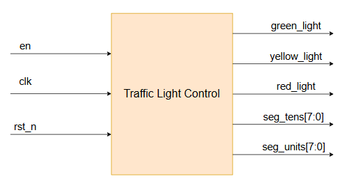
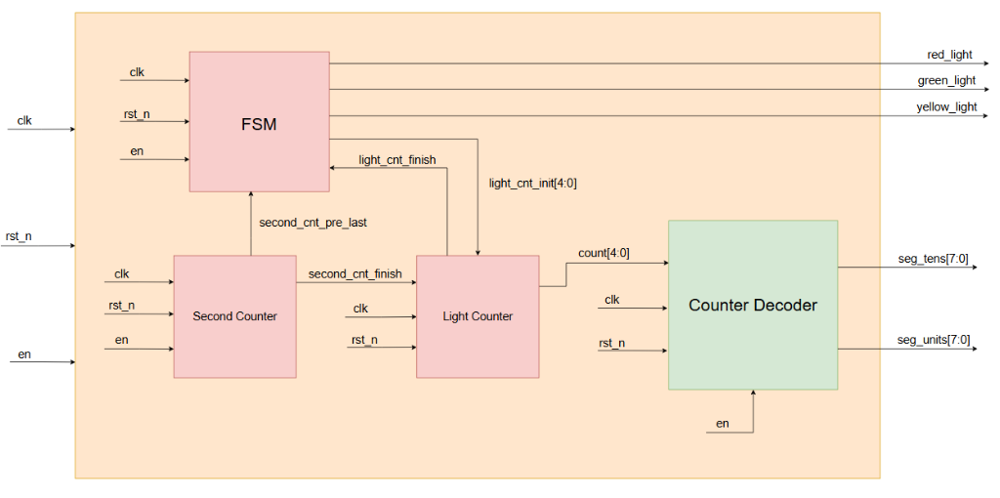
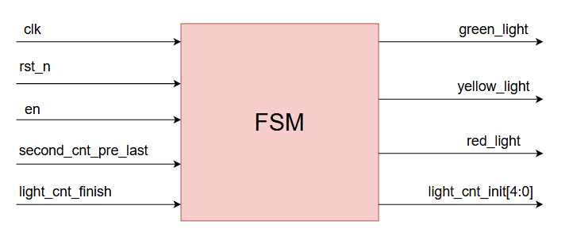
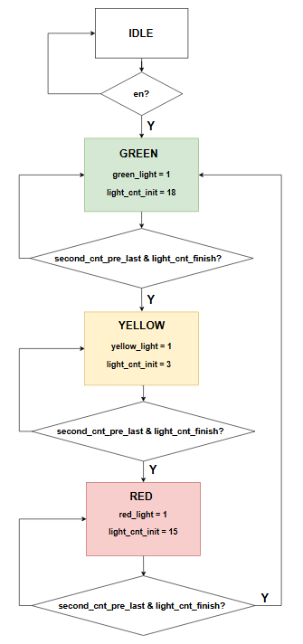
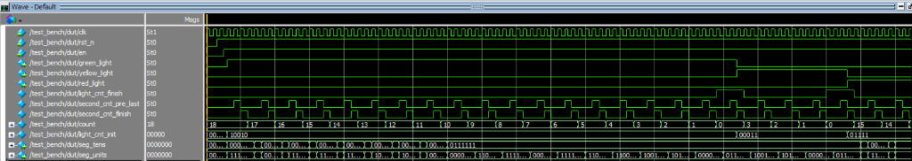

# 🚦 Automatic Traffic Light Controller & Dual 7-Segment Display

[](https://en.wikipedia.org/wiki/Verilog)
[]()
[]()

> **Tác giả (Author)**: Lê Anh Khoa ([@KhoaLe246205](https://github.com/KhoaLe246205))  
> **Trọng tâm thiết kế**: Thiết kế hệ thống điều khiển đèn giao thông tự động theo chu kỳ thời gian thực (**Xanh 18s $\rightarrow$ Vàng 3s $\rightarrow$ Đỏ 15s**), tích hợp bộ chia nhịp giây có tham số hóa tần số (`freq`), kỹ thuật bù trễ chuyển pha đón đầu (**Look-Ahead Pre-Last Synchronization**), thuật toán tách chữ số thập phân tuần tự (**Sequential Binary-to-BCD Splitter**) và bộ giải mã hiển thị kép lên 2 đèn LED 7 đoạn.

---

## 📑 Mục Lục (Table of Contents)
1. [Tổng Quan Hệ Thống (System Overview)](#1-tổng-quan-hệ-thống-system-overview)
2. [Kiến Trúc Phần Cứng & Sơ Đồ Khối (Hardware Architecture)](#2-kiến-trúc-phần-cứng--sơ-đồ-khối-hardware-architecture)
   - [2.1. Biểu Tượng Khối Mức Đỉnh (Top-Level Block Symbol)](#21-biểu-tượng-khối-mức-đỉnh-top-level-block-symbol)
   - [2.2. Sơ Đồ Kiến Trúc Mức Đỉnh Toàn Hệ Thống (Top Datapath Architecture)](#22-sơ-đồ-kiến-trúc-mức-đỉnh-toàn-hệ-thống-top-datapath-architecture)
3. [Đặc Tả Giao Tiếp Mức Đỉnh (Top-Level Interface)](#3-đặc-tả-giao-tiếp-mức-đỉnh-top-level-interface)
4. [Thiết Kế Máy Trạng Thái FSM & Các Khối Chức Năng (FSM & Submodules)](#4-thiết-kế-máy-trạng-thái-fsm--các-khối-chức-năng-fsm--submodules)
   - [4.1. Biểu Tượng Khối FSM (FSM Block Symbol)](#41-biểu-tượng-khối-fsm-fsm-block-symbol)
   - [4.2. Lưu Đồ Thuật Toán FSM (FSM Flowchart Diagram)](#42-lưu-đồ-thuật-toán-fsm-fsm-flowchart-diagram)
   - [4.3. Phân Tích Kỹ Thuật: Vai Trò Cốt Lõi Của Tín Hiệu `second_cnt_pre_last`](#43-phân-tích-kỹ-thuật-vai-trò-cốt-lõi-của-tín-hiệu-second_cnt_pre_last)
   - [4.4. Bộ Tạo Nhịp Giây & Bộ Đếm Thời Gian Đèn](#44-bộ-tạo-nhịp-giây--bộ-đếm-thời-gian-đèn)
   - [4.5. Khối Tách Số BCD & Giải Mã LED 7 Đoạn](#45-khối-tách-số-bcd--giải-mã-led-7-đoạn)
5. [Kết Quả Kiểm Chứng & Phân Tích Waveform (Verification & Simulation Analysis)](#5-kết-quả-kiểm-chứng--phân-tích-waveform-verification--simulation-analysis)
6. [Cấu Trúc Thư Mục & Tài Liệu (Directory Structure)](#6-cấu-trúc-thư-mục--tài-liệu-directory-structure)

---

## 1. Tổng Quan Hệ Thống (System Overview)

Hệ thống điều khiển đèn giao thông vận hành tự động và đồng bộ giữa tín hiệu điều khiển đèn (`green_light`, `yellow_light`, `red_light`) với bộ hiển thị đếm ngược 2 chữ số trên màn hình LED 7 đoạn (`seg_tens`, `seg_units`):
* **Pha Đèn Xanh (`GREEN`)**: Bật `green_light = 1`, đếm ngược từ **18 giây** về 0.
* **Pha Đèn Vàng (`YELLOW`)**: Bật `yellow_light = 1`, đếm ngược từ **3 giây** về 0.
* **Pha Đèn Đỏ (`RED`)**: Bật `red_light = 1`, đếm ngược từ **15 giây** về 0.
* **Tối ưu phần cứng tách số BCD**: Thay vì sử dụng mạch chia tổ hợp tốn nhiều diện tích cổng logic, khối `decimal_split.v` thực hiện tách hàng chục và hàng đơn vị bằng phương pháp trừ lặp (`-10`) theo xung nhịp hệ thống trước khi giải mã ra LED 7 đoạn.

---

## 2. Kiến Trúc Phần Cứng & Sơ Đồ Khối (Hardware Architecture)

### 2.1. Biểu Tượng Khối Mức Đỉnh (Top-Level Block Symbol)

<p align="center">
  
  <br>
  <em>Hình 1: Biểu tượng khối mức đỉnh Traffic Light Control và các cổng giao tiếp ngoại vi</em>
</p>

### 2.2. Sơ Đồ Kiến Trúc Mức Đỉnh Toàn Hệ Thống (Top Datapath Architecture)

Module mức đỉnh [`rtl/top.v`](rtl/top.v) kết nối 4 khối chức năng chính gồm: `FSM`, `Second Counter`, `Light Counter` và `Counter Decoder`:

<p align="center">
  
  <br>
  <em>Hình 2: Sơ đồ kiến trúc mức đỉnh kết nối luồng dữ liệu và điều khiển giữa các khối chức năng</em>
</p>

---

## 3. Đặc Tả Giao Tiếp Mức Đỉnh (Top-Level Interface)

### Tham số cấu hình (Parameters)
| Tên Tham Số | Giá Trị Mặc Định | Mô Tả Chức Năng |
| :--- | :---: | :--- |
| `freq` | `99` | Giá trị nạp đếm chu kỳ của bộ chia nhịp giây `second_counter`. Cho phép cấu hình linh hoạt từ module `top` (Ví dụ: `freq = 3` khi mô phỏng để rút ngắn thời gian, hoặc đặt tần số thực tế khi tổng hợp phần cứng). |

### Bảng tín hiệu cổng (Port Signals)
| Tên Cổng | Độ Rộng | Hướng | Mô Tả Chức Năng |
| :--- | :---: | :---: | :--- |
| `clk` | 1 bit | Input | Xung nhịp đồng bộ hệ thống (kích hoạt sườn dương `posedge`). |
| `rst_n` | 1 bit | Input | Tín hiệu Reset bất đồng bộ tích cực mức thấp (`negedge rst_n`). |
| `en` | 1 bit | Input | Tín hiệu cho phép hệ thống đèn giao thông hoạt động (`1`: Chạy, `0`: Tạm dừng). |
| `green_light` | 1 bit | Output | Tín hiệu điều khiển bật đèn Xanh (Active-High). |
| `yellow_light`| 1 bit | Output | Tín hiệu điều khiển bật đèn Vàng (Active-High). |
| `red_light` | 1 bit | Output | Tín hiệu điều khiển bật đèn Đỏ (Active-High). |
| `seg_tens` | 7 bit | Output | Bus điều khiển LED 7 đoạn hiển thị chữ số **hàng chục** (Active-High). |
| `seg_units` | 7 bit | Output | Bus điều khiển LED 7 đoạn hiển thị chữ số **hàng đơn vị** (Active-High). |

---

## 4. Thiết Kế Máy Trạng Thái FSM & Các Khối Chức Năng (FSM & Submodules)

### 4.1. Biểu Tượng Khối FSM (FSM Block Symbol)

<p align="center">
  
  <br>
  <em>Hình 3: Biểu tượng khối điều khiển trạng thái FSM (Finite State Machine)</em>
</p>

* **Đầu vào (Inputs)**: `clk`, `rst_n`, `en`, `second_cnt_pre_last`, `light_cnt_finish`.
* **Đầu ra (Outputs)**: `green_light`, `yellow_light`, `red_light`, `light_cnt_init[4:0]`.

---

### 4.2. Lưu Đồ Thuật Toán FSM (FSM Flowchart Diagram)

FSM được thiết kế theo mô hình **Moore Machine** 4 trạng thái (`IDLE`, `GREEN`, `YELLOW`, `RED`):

<p align="center">
  
  <br>
  <em>Hình 4: Lưu đồ thuật toán chuyển đổi trạng thái FSM</em>
</p>

#### Bảng Mã Hóa & Đặc Tả Hành Vi:
| Trạng Thái | Mã Hóa | Đèn Bật Sáng | Giá Trị Khởi Tạo Pha Tiếp Theo (`light_cnt_init`) | Điều Kiện Chuyển Pha |
| :---: | :---: | :---: | :---: | :--- |
| **`IDLE`** | `2'b00` | Tất cả tắt (`000`) | `5'd0` (`5'b00000`) | Chuyển sang `GREEN` khi `en = 1`. |
| **`GREEN`** | `2'b01` | `green_light = 1` | `5'd18` (`5'b10010`) | Chuyển sang `YELLOW` khi `light_cnt_finish & second_cnt_pre_last`. |
| **`YELLOW`**| `2'b10` | `yellow_light = 1` | `5'd3` (`5'b00011`) | Chuyển sang `RED` khi `light_cnt_finish & second_cnt_pre_last`. |
| **`RED`** | `2'b11` | `red_light = 1` | `5'd15` (`5'b01111`) | Chuyển sang `GREEN` khi `light_cnt_finish & second_cnt_pre_last`. |

---

### 4.3. Phân Tích Kỹ Thuật: Vai Trò Cốt Lõi Của Tín Hiệu `second_cnt_pre_last`

> **💡 Tại sao bắt buộc phải sử dụng `second_cnt_pre_last` thay vì `second_cnt_finish`?**

1. **Bản chất trễ 1 chu kỳ của FSM tuần tự (Sequential FSM Latency)**:
   * Trong module `FSM.v`, biến trạng thái được chốt vào thanh ghi đồng bộ:
     ```verilog
     always @(posedge clk or negedge rst_n) begin
         if (!rst_n) current_state <= IDLE;
         else        current_state <= next_state;
     end
     ```
     Điều này đồng nghĩa với việc FSM luôn mất đúng **1 chu kỳ xung clock** để chuyển từ `next_state` sang `current_state`.
2. **Mối quan hệ thời gian với `light_counter`**:
   * Khối `light_counter.v` chỉ cho phép đếm hoặc nạp lại khi có xung kết thúc giây `en = second_cnt_finish`:
     ```verilog
     else if (light_cnt_finish && en) count <= light_cnt_init;
     ```
   * Khi bộ đếm đèn đếm về `0` (`count == 0`), cờ `light_cnt_finish` bật lên `1` trong suốt giây cuối cùng đó.
   * Tại thời điểm giây cuối cùng sắp kết thúc (khi `second_counter` đếm tới `1`), cờ **`second_cnt_pre_last`** bật lên `1` (sớm hơn `second_cnt_finish` đúng **1 chu kỳ clock**).
3. **Cơ chế đón đầu đường ống (Look-Ahead Pipeline Trigger)**:
   * Khi `second_cnt_pre_last = 1` (lúc `second_count == 1`): Điều kiện `light_cnt_finish && second_cnt_pre_last` trở thành `TRUE`, FSM chuẩn bị sẵn `next_state` cho pha kế tiếp.
   * Ngay tại sườn clock tiếp theo (thời điểm `second_count` chạm `0` và `second_cnt_finish = 1`):
     * `current_state` chuyển sang trạng thái đèn mới (ví dụ từ `GREEN` sang `YELLOW`).
     * Ngõ ra `light_cnt_init` cập nhật đồng thời giá trị nạp mới (ví dụ `3` cho đèn Vàng).
     * Đúng lúc này, `light_counter` thấy `second_cnt_finish = 1` và `light_cnt_finish = 1`, nạp ngay lập tức `count <= light_cnt_init = 3`!
4. **Hậu quả nếu KHÔNG có `second_cnt_pre_last`**:
   * Nếu FSM dùng `second_cnt_finish`: Khi `second_cnt_finish = 1`, FSM mới bắt đầu tính toán `next_state`. Đến chu kỳ clock tiếp theo khi FSM chuyển sang màu đèn mới và phát ra `light_cnt_init`, thì xung `second_cnt_finish` đã tụt về `0` từ chu kỳ trước!
   * Khối `light_counter` sẽ bị lỡ mất nhịp nạp lại, dẫn tới hiện tượng bộ đếm bị trừ tiếp xuống âm (underflow sang `31`) hoặc đèn giao thông bị lệch pha hiển thị 1 nhịp so với thời gian thực tế.
   * Vì vậy, tín hiệu `second_cnt_pre_last` đóng vai trò **kích hoạt đón đầu (Look-ahead)**, đảm bảo quá trình chuyển màu đèn và nạp lại số đếm diễn ra **hoàn toàn đồng thời với độ trễ bằng 0 (Zero-Cycle Latency)**!

---

### 4.4. Bộ Tạo Nhịp Giây & Bộ Đếm Thời Gian Đèn
* **`second_counter.v`**: Đếm lùi từ `freq` về `0`. Phát cờ `second_cnt_pre_last` khi `second_count == 1` (báo trước 1 nhịp) và phát xung `second_cnt_finish` khi `second_count == 0` (báo hết 1 giây).
* **`light_counter.v`**: Bộ đếm lùi 5-bit `count`. Giảm 1 đơn vị mỗi khi nhận xung `second_cnt_finish`. Khi `count == 0`, bật cờ `light_cnt_finish = 1` và nạp lại `light_cnt_init` ở chu kỳ kết thúc pha.

---

### 4.5. Khối Tách Số BCD & Giải Mã LED 7 Đoạn
* **`decimal_split.v`**:
  * Phát hiện giá trị `count` thay đổi qua thanh ghi trễ `count_reg` (`count_change = (count != count_reg)`).
  * Nạp `units_count <= count` và xóa `tens_count <= 0`.
  * Trong các chu kỳ clock tiếp theo, nếu `units_count > 10` (`en_count = 1`), mạch thực hiện trừ 10 (`units_count <= units_count - 4'b1010`) và tăng hàng chục (`tens_count <= tens_count + 1`).
  * Khi hoàn tất tách số (`en_count = 0`), bật cờ `decode_en = 1` để đưa `tens` và `units` sang giải mã.
* **`hex2seg.v`**: Mạch tổ hợp giải mã BCD 4-bit (`0` $\rightarrow$ `9`) sang bus 7-bit điều khiển LED 7 đoạn (`seg_tens`, `seg_units`).

---

## 5. Kết Quả Kiểm Chứng & Phân Tích Waveform (Verification & Simulation Analysis)

File testbench [`tb/testbench.v`](tb/testbench.v) kiểm chứng toàn bộ hệ thống trên phần mềm **ModelSim ME**:

<p align="center">
  
  <br>
  <em>Hình 5: Dạng sóng mô phỏng kiểm chứng chu kỳ chuyển màu đèn Xanh (18) ➔ Vàng (3) ➔ Đỏ (15) và hiển thị LED 7 đoạn trên ModelSim</em>
</p>

### 5.1. Thiết lập tham số mô phỏng: Cấu hình `freq = 3`
> **Lưu ý quan trọng về tham số mô phỏng**:  
> * Trong ứng dụng thực tế trên chip FPGA/ASIC, tham số `freq` được đặt bằng giá trị lớn (ví dụ `50_000_000` với thạch anh 50 MHz) để tạo đúng nhịp thời gian 1 giây.  
> * Tuy nhiên, trong mô phỏng dạng sóng trên ModelSim, tham số `freq` được cấu hình là **`3`** (`parameter freq = 3`).  
> * Với `freq = 3`, mỗi chu kỳ "giây" diễn ra gói gọn trong **4 chu kỳ xung clock** ($3 \rightarrow 2 \rightarrow 1 \rightarrow 0$). Việc rút ngắn này giúp toàn bộ chuỗi đếm ngược của cả 3 pha đèn (**Xanh 18s $\rightarrow$ Vàng 3s $\rightarrow$ Đỏ 15s**) hiển thị đầy đủ, rõ ràng và trực quan trên màn hình mà không cần tốn thời gian chạy hàng triệu chu kỳ mô phỏng.

### 5.2. Diễn biến chi tiết trên Waveform
1. **Khởi động & Pha Đèn Xanh (`GREEN`)**:
   * Khi `en = 1`, FSM kích hoạt đèn Xanh: `green_light = 1`.
   * Bộ đếm nạp giá trị ban đầu `count = 18`.
   * Tại mỗi nhịp xung `second_cnt_finish = 1`, `count` giảm dần đều: $18 \rightarrow 17 \rightarrow 16 \rightarrow \dots \rightarrow 1 \rightarrow 0$.
   * Bộ giải mã `seg_tens` và `seg_units` cập nhật liên tục các chữ số đếm lùi tương ứng.
2. **Chuyển tiếp sang Pha Đèn Vàng (`YELLOW`)**:
   * Khi `count = 0`, cờ `light_cnt_finish = 1`.
   * Ở chu kỳ kế cuối của giây số 0, `second_cnt_pre_last` bật lên `1`.
   * Ngay sườn clock tiếp theo: `green_light` tắt, `yellow_light` bật lên `1`, đồng thời `count` được nạp lại chính xác về **`3`**.
   * Bộ đếm tiếp tục đếm lùi: $3 \rightarrow 2 \rightarrow 1 \rightarrow 0$.
3. **Chuyển tiếp sang Pha Đèn Đỏ (`RED`)**:
   * Khi đèn Vàng đếm hết về `0`, tổ hợp `light_cnt_finish && second_cnt_pre_last` lại đón đầu chính xác: `yellow_light` tắt, `red_light` bật lên `1`.
   * Bộ đếm nạp lại giá trị **`15`** và tiếp tục đếm lùi: $15 \rightarrow 14 \rightarrow \dots$.

---

## 6. Cấu Trúc Thư Mục & Tài Liệu (Directory Structure)

```text
03_Traffic_Light_Controller/
├── images/
│   ├── traffic_light_top_symbol.png        # Biểu tượng khối mức đỉnh
│   ├── traffic_light_top_architecture.png  # Sơ đồ kiến trúc mức đỉnh kết nối 4 khối con
│   ├── traffic_light_fsm_symbol.png        # Biểu tượng khối điều khiển FSM
│   ├── traffic_light_fsm_state_diagram.png # Lưu đồ thuật toán chuyển đổi trạng thái FSM
│   └── traffic_light_waveform.png          # Dạng sóng mô phỏng kiểm chứng trên ModelSim
├── docs/
│   ├── Top_Module_Design.drawio            # Sơ đồ kiến trúc mức đỉnh (Draw.io)
│   ├── FSM_Block_Design.drawio             # Sơ đồ khối giao diện FSM
│   ├── FSM_State.drawio                    # Lưu đồ thuật toán FSM
│   ├── Second_Counter_Design.drawio        # Sơ đồ mạch bộ đếm chia nhịp giây
│   ├── Light_Counter_Design.drawio         # Sơ đồ mạch bộ đếm thời gian đèn
│   ├── Counter_Decoder_Design.drawio       # Sơ đồ khối giải mã hiển thị
│   ├── Decimal_Split_Design.drawio         # Sơ đồ mạch tách chữ số hàng chục/đơn vị
│   ├── Binary_To_BCD_Design.drawio         # Bản vẽ thuật toán chuyển đổi BCD
│   ├── Waveform.xlsx                       # Bảng phân tích giản đồ thời gian từng chu kỳ
│   └── Traffic_Light_Control.pptx          # Slide thuyết trình toàn bộ dự án
├── rtl/
│   ├── top.v                               # Module mức đỉnh (parameter freq = 99)
│   ├── FSM.v                               # Máy trạng thái điều khiển chu kỳ đèn
│   ├── second_counter.v                    # Bộ đếm tạo nhịp thời gian (parameter freq = 99)
│   ├── light_counter.v                     # Bộ đếm ngược thời gian từng màu đèn
│   ├── counter_decoder.v                   # Module ghép nối bộ tách số và giải mã LED
│   ├── decimal_split.v                     # Khối tách số nhị phân 5-bit sang BCD
│   └── hex2seg.v                           # Bộ giải mã BCD sang LED 7 đoạn
├── tb/
│   └── testbench.v                         # Testbench mô phỏng hệ thống
└── README.md                               # Tài liệu kỹ thuật chi tiết của dự án Traffic Light
```
