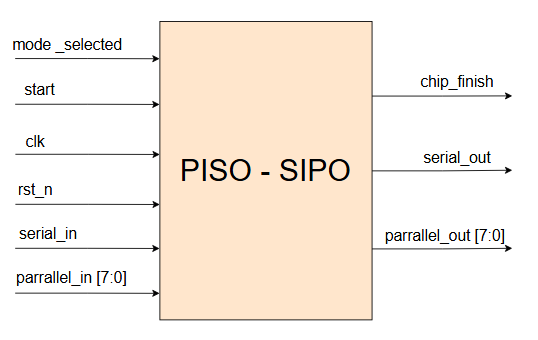
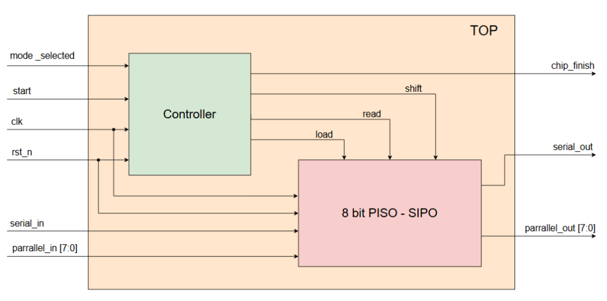
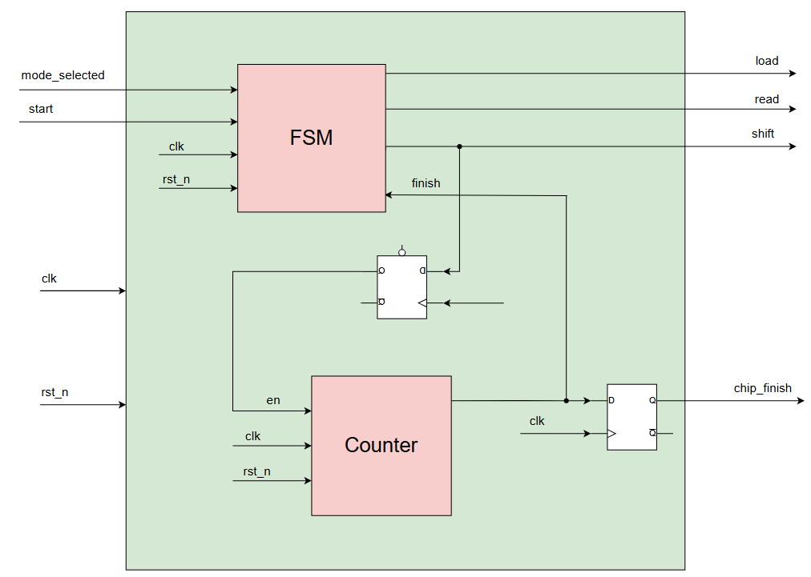
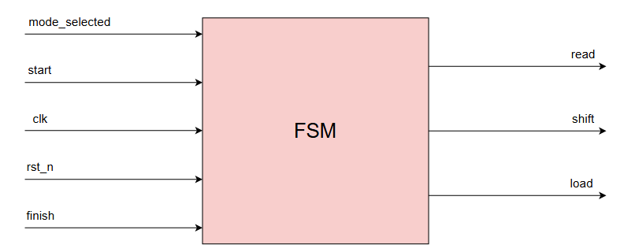
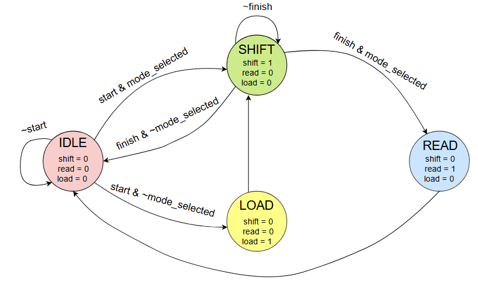
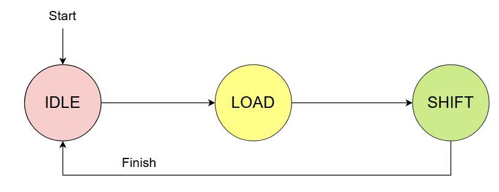
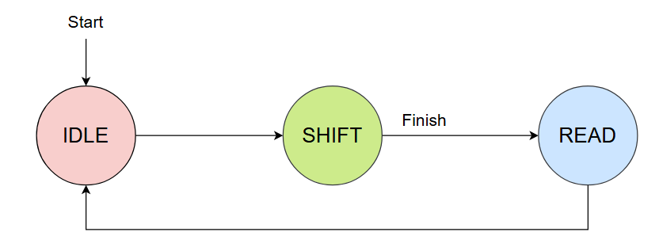
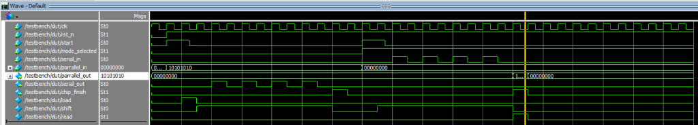

# 🔄 Bidirectional 8-Bit PISO / SIPO Shift Register Transceiver

[](https://en.wikipedia.org/wiki/Verilog)
[]()
[]()

> **Tác giả (Author)**: Lê Anh Khoa ([@KhoaLe246205](https://github.com/KhoaLe246205))  
> **Trọng tâm thiết kế**: Thiết kế bộ chuyển đổi dữ liệu hai chiều 8-bit tích hợp cả hai chế độ **PISO (Parallel-In Serial-Out / Song song sang Nối tiếp)** và **SIPO (Serial-In Parallel-Out / Nối tiếp sang Song song)** trên cùng một lõi thanh ghi dịch dùng chung (Unified Shift Register Datapath). Hệ thống được điều phối bởi máy trạng thái hữu hạn Moore 4 trạng thái (FSM), bộ đếm chu kỳ bit (3-bit Counter) và cơ chế chốt cờ bắt tay đồng bộ (`chip_finish`).

---

## 📑 Mục Lục (Table of Contents)
1. [Tổng Quan Hệ Thống & Bài Toán Kỹ Thuật (System Overview)](#1-tổng-quan-hệ-thống--bài-toán-kỹ-thuật-system-overview)
2. [Đặc Tả Giao Tiếp Mức Đỉnh & Sơ Đồ Khối (Top-Level Interface & Symbol)](#2-đặc-tả-giao-tiếp-mức-đỉnh--sơ-đồ-khối-top-level-interface--symbol)
3. [Kiến Trúc Phần Cứng Phân Tầng (Hierarchical Hardware Architecture)](#3-kiến-trúc-phần-cứng-phân-tầng-hierarchical-hardware-architecture)
   - [3.1. Sơ Đồ Kiến Trúc Mức Đỉnh (Top-Level Architecture)](#31-sơ-đồ-kiến-trúc-mức-đỉnh-top-level-architecture)
   - [3.2. Vi Kiến Trúc Khối Điều Khiển (Controller Architecture)](#32-vi-kiến-trúc-khối-điều-khiển-controller-architecture)
   - [3.3. Khối Máy Trạng Thái FSM & Giải Mã Điều Khiển (FSM Controller)](#33-khối-máy-trạng-thái-fsm--giải-mã-điều-khiển-fsm-controller)
     - [3.3.1. Biểu Tượng Khối FSM (FSM Block Symbol)](#331-biểu-tượng-khối-fsm-fsm-block-symbol)
     - [3.3.2. Sơ Đồ Chuyển Trạng Thái (FSM State Transition Diagram)](#332-sơ-đồ-chuyển-trạng-thái-fsm-state-transition-diagram)
   - [3.4. Khối Bộ Đếm Chu Kỳ Dịch (3-Bit Counter)](#34-khối-bộ-đếm-chu-kỳ-dịch-3-bit-counter)
   - [3.5. Khối Thanh Ghi Dịch Hợp Nhất 8-Bit (Unified Shift Register Datapath)](#35-khối-thanh-ghi-dịch-hợp-nhất-8-bit-unified-shift-register-datapath)
4. [Nguyên Lý Hoạt Động & Lưu Đồ Pha Chuyển Đổi (Operational Flow)](#4-nguyên-lý-hoạt-động--lưu-đồ-pha-chuyển-đổi-operational-flow)
   - [4.1. Quy Trình Chế Độ PISO (Parallel-In Serial-Out Flow)](#41-quy-trình-chế-độ-piso-parallel-in-serial-out-flow)
   - [4.2. Quy Trình Chế Độ SIPO (Serial-In Parallel-Out Flow)](#42-quy-trình-chế-độ-sipo-serial-in-parallel-out-flow)
5. [Kết Quả Kiểm Chứng & Phân Tích Dạng Sóng (Verification & Waveform Analysis)](#5-kết-quả-kiểm-chứng--phân-tích-dạng-sóng-verification--waveform-analysis)
   - [5.1. Phân Tích Giao Dịch PISO (PISO Mode Timing Breakdown)](#51-phân-tích-giao-dịch-piso-piso-mode-timing-breakdown)
   - [5.2. Phân Tích Giao Dịch SIPO (SIPO Mode Timing Breakdown)](#52-phân-tích-giao-dịch-sipo-sipo-mode-timing-breakdown)
6. [Hướng Dẫn Biên Dịch & Mô Phỏng (Simulation Guide)](#6-hướng-dẫn-biên-dịch--mô-phỏng-simulation-guide)
7. [Cấu Trúc Thư Mục Dự Án (Directory Structure)](#7-cấu-trúc-thư-mục-dự-án-directory-structure)

---

## 1. Tổng Quan Hệ Thống & Bài Toán Kỹ Thuật (System Overview)

Trong thiết kế vi mạch số (VLSI / ASIC) và các hệ thống vi xử lý SoC, việc trao đổi dữ liệu giữa các khối tính toán song song nội bộ (Parallel Processing Cores) và các thiết bị ngoại vi nối tiếp (Serial Peripherals như SPI, UART, I2S) là một bài toán nền tảng:
* **Bộ phát (Transmitter / Serializer)**: Đòi hỏi chuyển đổi một từ dữ liệu song song 8-bit từ bus hệ thống thành một chuỗi xung nối tiếp 1-bit để truyền qua một đường dây duy nhất, giúp tiết kiệm tối đa số lượng chân cắm (pin count) và diện tích định tuyến kim loại.
* **Bộ thu (Receiver / Deserializer)**: Đòi hỏi lấy mẫu luồng bit nối tiếp qua từng chu kỳ xung nhịp, dồn đủ 8 bit và chuyển đổi ngược lại thành bus song song hoàn chỉnh để bộ vi xử lý đọc đồng loạt.

Thông thường, các thiết kế số truyền thống tách riêng hai module phần cứng: một module PISO và một module SIPO độc lập. Tuy nhiên, cách tiếp cận này gây lãng phí tài nguyên silicon:
1. **Lãng phí Flip-Flop**: Cần tối thiểu 16 Flip-Flop cho hai thanh ghi dữ liệu riêng biệt.
2. **Tăng diện tích Cell và công suất tĩnh**: Tăng số lượng cell thư viện tiêu chuẩn (Standard Cells) và diện tích chiếm dụng trên chip.

Thiết kế **Bidirectional 8-Bit PISO / SIPO Shift Register Transceiver** này giải quyết triệt để vấn đề trên thông qua giải pháp **lõi phần cứng chia sẻ (Shared Hardware Datapath)**:
* Hợp nhất chức năng của cả PISO và SIPO vào **duy nhất một thanh ghi 8-bit dùng chung**.
* Cấu hình linh hoạt chế độ làm việc qua chân điều khiển `mode_selected`.
* Tự động điều phối toàn bộ chu trình nạp dữ liệu, dịch bit và xuất dữ liệu thông qua máy trạng thái FSM kết hợp bộ đếm chu kỳ và cơ chế bắt tay `chip_finish`.

---

## 2. Đặc Tả Giao Tiếp Mức Đỉnh & Sơ Đồ Khối (Top-Level Interface & Symbol)

Khối chuyển đổi mức đỉnh [`rtl/top.v`](rtl/top.v) cung cấp giao tiếp điều khiển và truyền nhận dữ liệu hoàn chỉnh:

<p align="center">
  
  <br>
  <em>Hình 1: Biểu tượng khối mức đỉnh (Top-Level Block Symbol) của PISO - SIPO Transceiver</em>
</p>

### Bảng Đặc Tả Tín Hiệu (Pin Description Table)

| Tên Cổng (Port) | Độ Rộng | Hướng | Miêu Tả Chức Năng Chi Tiết (Functional Description) |
| :--- | :---: | :---: | :--- |
| `clk` | 1 bit | Input | Xung nhịp hệ thống toàn cục, kích hoạt đồng bộ ở sườn dương (`posedge clk`). |
| `rst_n` | 1 bit | Input | Tín hiệu Reset bất đồng bộ tích cực mức thấp (`negedge rst_n`), khởi tạo toàn bộ thanh ghi và FSM về trạng thái an toàn `IDLE`. |
| `start` | 1 bit | Input | Xung kích hoạt bắt đầu một phiên truyền/nhận mới từ hệ thống Host / Controller bên ngoài. |
| `mode_selected` | 1 bit | Input | Chân chọn chế độ làm việc:<br>• `1'b0`: **Chế độ PISO** (Song song sang Nối tiếp).<br>• `1'b1`: **Chế độ SIPO** (Nối tiếp sang Song song). |
| `serial_in` | 1 bit | Input | Ngõ vào dữ liệu nối tiếp từng bit (sử dụng trong chế độ **SIPO**). |
| `parrallel_in[7:0]` | 8 bit | Input | Bus dữ liệu song song 8-bit ngõ vào được nạp vào thanh ghi (sử dụng trong chế độ **PISO**). |
| `chip_finish` | 1 bit | Output | Xung báo hoàn tất giao dịch rộng đúng 1 chu kỳ clock, thông báo phiên chuyển đổi 8-bit hiện tại đã hoàn thành. |
| `serial_out` | 1 bit | Output | Ngõ ra dữ liệu nối tiếp từng bit (sử dụng trong chế độ **PISO**, bit MSB phát ra trước). |
| `parrallel_out[7:0]` | 8 bit | Output | Bus dữ liệu song song 8-bit ngõ ra sau khi ghép đủ 8 bit nối tiếp (sử dụng trong chế độ **SIPO**, có mạch cổng hóa an toàn). |

---

## 3. Kiến Trúc Phần Cứng Phân Tầng (Hierarchical Hardware Architecture)

Hệ thống được thiết kế theo tư duy phân tách rõ ràng giữa **Khối Điều Khiển (Control Unit)** và **Khối Đường Dữ Liệu (Datapath)**.

### 3.1. Sơ Đồ Kiến Trúc Mức Đỉnh (Top-Level Architecture)

<p align="center">
  
  <br>
  <em>Hình 2: Sơ đồ kiến trúc mức đỉnh (TOP) liên kết giữa Controller và lõi 8-bit PISO - SIPO Datapath</em>
</p>

Module mức đỉnh [`rtl/top.v`](rtl/top.v) kết nối 2 thành phần chính:
1. **`controller.v` (Khối điều khiển trung tâm)**: Tiếp nhận các lệnh khởi động `start`, trạng thái chế độ `mode_selected` và xung nhịp `clk`, `rst_n` để điều phối các đường tín hiệu điều khiển vi kiến trúc:
   * `load`: Xung cho phép nạp dữ liệu song song vào thanh ghi.
   * `shift`: Tín hiệu kích hoạt chế độ dịch bit.
   * `read`: Tín hiệu mở cổng bus xuất dữ liệu song song ra ngoài.
   * `chip_finish`: Cờ báo hoàn thành giao dịch đưa ra giao tiếp ngoại vi.
2. **`PISO_SIPO_8bit.v` (Khối Datapath 8-bit)**: Chứa thanh ghi lưu trữ và dịch chuyển dữ liệu vật lý, trực tiếp nhận dữ liệu song song `parrallel_in[7:0]` và dữ liệu nối tiếp `serial_in`, đưa ra ngõ nối tiếp `serial_out` hoặc bus song song `parrallel_out[7:0]`.

---

### 3.2. Vi Kiến Trúc Khối Điều Khiển (Controller Architecture)

Bên trong [`rtl/controller.v`](rtl/controller.v), khối điều khiển là sự kết hợp chặt chẽ giữa máy trạng thái `FSM`, bộ đếm chu kỳ `Counter` và 2 tầng D-Flip-Flop đồng bộ hóa:

<p align="center">
  
  <br>
  <em>Hình 3: Vi kiến trúc bên trong khối Controller kết nối FSM, Counter và các tầng D-Flip-Flop chốt nhịp</em>
</p>

#### Chi tiết các đường dẫn tín hiệu trong Controller:
* **Tầng Flip-Flop tạo tín hiệu cho phép đếm (`en`)**:
  ```verilog
  assign shift = shift_wire;
  assign en = shift_reg;

  always @(posedge clk or negedge rst_n) begin
      if(!rst_n) begin
          shift_reg   <= 1'b0;
          chip_finish <= 1'b0;
      end else begin
          shift_reg   <= shift_wire;
          chip_finish <= finish;
      end
  end
  ```
  * Tín hiệu `shift_wire` từ FSM xuất hiện đồng thời ngay khi FSM chuyển sang trạng thái `SHIFT`.
  * Thay vì đưa trực tiếp `shift_wire` vào chân cho phép đếm `en` của bộ đếm, tín hiệu này được đưa qua tầng chốt `shift_reg <= shift_wire`.
  * Việc đưa qua tầng D-FF trễ 1 chu kỳ clock đảm bảo xung nhịp cho phép đếm `en` khớp chính xác với nhịp bắt đầu dịch dữ liệu của thanh ghi, ngăn ngừa tình trạng trôi đếm (skew / timing race condition) giữa mạch logic điều khiển và đường dữ liệu.
* **Tầng Flip-Flop chốt cờ kết thúc (`chip_finish`)**:
  * Khi bộ đếm đạt cực đại (`count == 3'b111`), cờ báo `finish` được kích hoạt.
  * Tín hiệu `finish` được chốt qua một D-Flip-Flop để sinh ra cờ ngõ ra `chip_finish <= finish`. Nhờ đó, cờ hoàn tất được đảm bảo là một xung xung nhịp chuẩn (registered output), triệt tiêu hoàn toàn các gai xung tổ hợp (glitches), an toàn tuyệt đối khi đưa sang các khối logic khác trong SoC.

---

### 3.3. Khối Máy Trạng Thái FSM & Giải Mã Điều Khiển (FSM Controller)

Khối [`rtl/FSM.v`](rtl/FSM.v) được mô hình hóa theo kiến trúc máy trạng thái hữu hạn Moore (Moore Finite State Machine) với 4 trạng thái mã hóa 2-bit:

#### 3.3.1. Biểu Tượng Khối FSM (FSM Block Symbol)

<p align="center">
  
  <br>
  <em>Hình 4: Biểu tượng khối máy trạng thái hữu hạn (FSM Controller Symbol)</em>
</p>

#### 3.3.2. Sơ Đồ Chuyển Trạng Thái (FSM State Transition Diagram)

<p align="center">
  
  <br>
  <em>Hình 5: Sơ đồ không gian trạng thái và điều kiện chuyển dịch của FSM điều khiển PISO / SIPO</em>
</p>

#### Bảng Mã Hóa Trạng Thái & Ngõ Ra Điều Khiển

| Tên Trạng Thái | Mã Hóa (Binary) | `load` | `shift` | `read` | Mô Tả Chức Năng |
| :---: | :---: | :---: | :---: | :---: | :--- |
| **`IDLE`** | `2'b00` | `0` | `0` | `0` | Trạng thái nghỉ. Chờ tín hiệu kích hoạt `start = 1`. Kiểm tra chân chọn chế độ `mode_selected` để rẽ nhánh. |
| **`LOAD`** | `2'b01` | `1` | `0` | `0` | Chỉ dùng trong chế độ PISO. Kéo dài 1 chu kỳ clock để nạp dữ liệu song song `parrallel_in` vào thanh ghi. |
| **`SHIFT`** | `2'b11` | `0` | `1` | `0` | Kích hoạt dịch dữ liệu liên tục trong 8 chu kỳ clock. Lấy tín hiệu `finish` từ Counter làm điều kiện thoát. |
| **`READ`** | `2'b10` | `0` | `0` | `1` | Chỉ dùng trong chế độ SIPO. Kéo dài 1 chu kỳ clock để mở cổng xuất dữ liệu song song ra `parrallel_out`. |

#### Phân Tích Logic Chuyển Trạng Thái Của FSM (FSM State Transition Analysis)

Quan sát trực tiếp sơ đồ trạng thái (*Hình 5*):
* **Trạng thái `IDLE` (Màu hồng - Mã hóa `2'b00`)**:
  * Các tín hiệu điều khiển ngõ ra: `shift = 0`, `read = 0`, `load = 0`.
  * **Vòng lặp giữ trạng thái**: Khi `~start` (chưa có lệnh bắt đầu), FSM giữ nguyên tại `IDLE`.
  * **Chuyển sang `LOAD`**: Khi có điều kiện `start & ~mode_selected` (kích hoạt chế độ PISO), FSM chuyển sang `LOAD` để nạp dữ liệu song song vào thanh ghi.
  * **Chuyển sang `SHIFT`**: Khi có điều kiện `start & mode_selected` (kích hoạt chế độ SIPO), FSM chuyển thẳng sang `SHIFT`, bỏ qua pha `LOAD` vì chế độ SIPO nhận dữ liệu nối tiếp từ ngoài vào mà không cần nạp dữ liệu song song ban đầu.
* **Trạng thái `LOAD` (Màu vàng - Mã hóa `2'b01`)**:
  * Tín hiệu điều khiển: `shift = 0`, `read = 0`, `load = 1`.
  * Kéo dài đúng 1 chu kỳ clock để thanh ghi `data_reg` chốt byte dữ liệu `parrallel_in`.
  * Chuyển tiếp vô điều kiện sang trạng thái `SHIFT` ở chu kỳ xung nhịp kế tiếp.
* **Trạng thái `SHIFT` (Màu xanh lá - Mã hóa `2'b11`)**:
  * Tín hiệu điều khiển: `shift = 1`, `read = 0`, `load = 0`.
  * **Vòng lặp giữ trạng thái**: Khi `~finish` (bộ đếm chưa đếm đủ 8 bit, `count < 3'b111`), FSM tiếp tục duy trì tại `SHIFT` để thực hiện dịch từng bit.
  * **Kết thúc chế độ PISO**: Khi có điều kiện `finish & ~mode_selected` (đã dịch xong 8 bit nối tiếp ra chân `serial_out`), FSM chuyển thẳng về `IDLE`.
  * **Kết thúc chế độ SIPO**: Khi có điều kiện `finish & mode_selected` (đã thu đủ 8 bit nối tiếp từ chân `serial_in` vào thanh ghi), FSM chuyển sang trạng thái `READ` để cho phép đọc dữ liệu.
* **Trạng thái `READ` (Màu xanh dương - Mã hóa `2'b10`)**:
  * Tín hiệu điều khiển: `shift = 0`, `read = 1`, `load = 0`.
  * Tín hiệu `read = 1` kích hoạt mạch cổng hóa mở bus dữ liệu `parrallel_out = data_reg` trong đúng 1 chu kỳ clock.
  * Sau khi xuất dữ liệu, FSM tự động chuyển vô điều kiện về `IDLE` để kết thúc phiên làm việc.

---

### 3.4. Khối Bộ Đếm Chu Kỳ Dịch (3-Bit Counter)

Module [`rtl/counter.v`](rtl/counter.v) đóng vai trò định thời số lượng bit dịch:
```verilog
always @(posedge clk or negedge rst_n) begin 
    if(!rst_n) 
        count <= 3'b0;
    else if (en) 
        count <= count + 1'b1;
    else 
        count <= 3'b0;
end

assign finish = (count == 3'b111) ? 1'b1 : 1'b0;
```
* Bộ đếm 3-bit quản lý chính xác $2^3 = 8$ trạng thái đếm (từ `3'b000` đến `3'b111`).
* Khi tín hiệu `en` được kích hoạt, giá trị bộ đếm tăng dần ở mỗi sườn dương xung nhịp.
* Khi đạt giá trị cực đại `3'b111` (ứng với chu kỳ dịch thứ 8), bộ giải mã so sánh lập tức kéo cờ `finish = 1` để thông báo cho FSM hoàn tất pha dịch. Khi `en = 0`, bộ đếm được reset đồng bộ về `3'b000`.

---

### 3.5. Khối Thanh Ghi Dịch Hợp Nhất 8-Bit (Unified Shift Register Datapath)

Khối [`rtl/PISO_SIPO_8bit.v`](rtl/PISO_SIPO_8bit.v) là trái tim phần cứng của đường dữ liệu:

```verilog
always @(posedge clk or negedge rst_n) begin
    if(!rst_n) begin
        data_reg       <= 8'b0;
        serial_out_reg <= 1'b0;
    end else if (load) 
        data_reg <= parrallel_in;
    else if (shift) begin
        serial_out_reg <= data_reg[7];
        data_reg       <= {data_reg[6:0], serial_in};
    end else begin
        serial_out_reg <= 0;
        data_reg       <= data_reg;
    end
end

assign serial_out    = serial_out_reg;
assign parrallel_out = (read) ? data_reg : 8'b0;
```

#### Hai Ưu Điểm Thiết Kế Phần Cứng Nổi Bật:
1. **Lõi Dịch Hợp Nhất Tiết Kiệm Diện Tích (Hardware Resource Sharing)**:
   * Toàn bộ thao tác nạp song song, dịch bit ra nối tiếp, thu bit nối tiếp và đọc song song đều thao tác trên **một thanh ghi 8-bit `data_reg` duy nhất**.
   * Trong thao tác dịch `shift`: câu lệnh gán ghép `data_reg <= {data_reg[6:0], serial_in};` vừa đẩy bit cao nhất `data_reg[7]` ra chân nối tiếp qua `serial_out_reg` (chế độ PISO), vừa đồng thời chèn bit nối tiếp ngõ vào `serial_in` vào vị trí LSB (chế độ SIPO). Giải pháp này giúp cắt giảm 50% số lượng Flip-Flop lưu trữ dữ liệu so với kiến trúc phân tách hai khối riêng biệt.
2. **Cơ Chế Cổng Hóa Bus Ngõ Ra (Bus Output Gating)**:
   * Đường ra song song được bảo vệ qua mạch giải mã có điều kiện: `assign parrallel_out = (read) ? data_reg : 8'b0;`.
   * **Ý nghĩa thiết kế**: Trong suốt quá trình dịch bit của cả hai chế độ PISO và SIPO, dữ liệu bên trong `data_reg` liên tục thay đổi ở mỗi chu kỳ clock. Nếu nối trực tiếp ra bus ngoài, các bit dao động liên tục (switching activity) sẽ gây tiêu tán công suất động vô ích và có nguy cơ khiến mạch thu bên ngoài đọc nhầm dữ liệu quá độ. Cơ chế cổng hóa ép `parrallel_out` về `8'b0` và chỉ mở ra giá trị chính xác duy nhất trong đúng 1 chu kỳ của trạng thái `READ`.

---

## 4. Nguyên Lý Hoạt Động & Lưu Đồ Pha Chuyển Đổi (Operational Flow)

### 4.1. Quy Trình Chế Độ PISO (Parallel-In Serial-Out Flow)

Khi hoạt động ở chế độ PISO (`mode_selected = 0`), chu trình chuyển đổi diễn ra tuần tự qua các trạng thái:

<p align="center">
  
  <br>
  <em>Hình 6: Lưu đồ không gian trạng thái hoạt động của chế độ PISO (Start &rarr; IDLE &rarr; LOAD &rarr; SHIFT &rarr; Finish &rarr; IDLE)</em>
</p>

1. **Khởi động**: Hệ thống ban đầu ở trạng thái nghỉ `IDLE`. Khi nhận xung kích hoạt `Start` (`start = 1`) và `mode_selected = 0`, FSM lập tức chuyển sang trạng thái `LOAD`.
2. **Nạp dữ liệu (`LOAD`)**: Tín hiệu `load = 1` được kích hoạt trong đúng 1 chu kỳ xung nhịp. Thanh ghi `data_reg` chốt nguyên vẹn byte dữ liệu song song 8-bit từ bus `parrallel_in[7:0]`.
3. **Dịch dữ liệu ra nối tiếp (`SHIFT`)**: FSM chuyển sang trạng thái `SHIFT`. Tín hiệu `shift = 1` kéo dài trong suốt 8 chu kỳ xung nhịp. Tại mỗi chu kỳ, bit cao nhất MSB (`data_reg[7]`) được đưa tuần tự ra ngõ nối tiếp `serial_out`, đồng thời thanh ghi dịch trái để chuẩn bị cho bit kế tiếp.
4. **Báo hoàn tất (`Finish`)**: Tại chu kỳ dịch thứ 8, bộ đếm bit phát cờ `Finish` (`finish = 1`). FSM lập tức quay trở lại trạng thái `IDLE`, đồng thời tầng Flip-Flop ngõ ra phát xung `chip_finish = 1` rộng 1 chu kỳ clock để thông báo quá trình truyền nối tiếp đã hoàn tất thành công.

---

### 4.2. Quy Trình Chế Độ SIPO (Serial-In Parallel-Out Flow)

Khi hoạt động ở chế độ SIPO (`mode_selected = 1`), chu trình chuyển đổi diễn ra tuần tự qua các trạng thái:

<p align="center">
  
  <br>
  <em>Hình 7: Lưu đồ không gian trạng thái hoạt động của chế độ SIPO (Start &rarr; IDLE &rarr; SHIFT &rarr; Finish &rarr; READ &rarr; IDLE)</em>
</p>

1. **Khởi động**: Khi nhận xung kích hoạt `Start` (`start = 1`) với `mode_selected = 1`, FSM bỏ qua pha `LOAD` và nhảy thẳng vào trạng thái `SHIFT` (do chế độ SIPO thu nhận dữ liệu nối tiếp từ bên ngoài mà không cần nạp song song trước).
2. **Thu nhận dữ liệu nối tiếp (`SHIFT`)**: Tín hiệu `shift = 1` duy trì trong 8 chu kỳ xung nhịp liên tiếp. Tại mỗi sườn dương của `clk`, bit nối tiếp mới từ chân `serial_in` được nạp vào vị trí LSB của `data_reg` và đẩy các bit cũ dịch sang trái. Trong suốt thời gian này, bus `parrallel_out` vẫn được giữ ở mức `8'b0` nhờ mạch cổng hóa.
3. **Xuất dữ liệu song song (`READ`)**: Sau khi đã thu thập đủ 8 bit, Counter phát cờ `Finish` (`finish = 1`). FSM chuyển sang trạng thái `READ` (`read = 1`). Mạch cổng hóa mở đường cho toàn bộ 8-bit dữ liệu hoàn chỉnh từ `data_reg` xuất đồng loạt ra bus song song `parrallel_out[7:0]`.
4. **Bắt tay đồng bộ**: Cờ hoàn tất `chip_finish = 1` được kích hoạt đồng thời ngay trong chu kỳ `READ`, báo hiệu cho Master bên ngoài chốt dữ liệu song song an toàn. Kế tiếp, FSM tự động quay trở về trạng thái nghỉ `IDLE`.

---

## 5. Kết Quả Kiểm Chứng & Phân Tích Dạng Sóng (Verification & Waveform Analysis)

Kịch bản kiểm thử toàn diện được thực thi trong file [`tb/testbench.v`](tb/testbench.v) (đã đồng bộ quy ước từ `top_tb.v`), kiểm tra liên tiếp cả 2 chế độ PISO và SIPO trên công cụ mô phỏng chuẩn công nghiệp **ModelSim / QuestaSim**:

<p align="center">
  
  <br>
  <em>Hình 8: Dạng sóng mô phỏng ModelSim kiểm chứng chi tiết giao dịch PISO (nửa trái) và giao dịch SIPO (nửa phải)</em>
</p>

---

### 5.1. Phân Tích Giao Dịch PISO (PISO Mode Timing Breakdown)

Quan sát nửa đầu của dạng sóng mô phỏng (*Hình 8*):
1. **Thiết lập đầu vào**:
   * Chân chọn chế độ: `mode_selected = 0` (chế độ PISO).
   * Bus song song đầu vào: `parrallel_in = 8'b10101010` (giá trị Hex `0xAA`).
   * Xung kích hoạt: Kích xung `start = 1` trong 1 chu kỳ clock.
2. **Pha nạp dữ liệu (`LOAD`)**:
   * Ngay sau sườn lên xung nhịp, FSM chuyển từ `IDLE` sang `LOAD` $\rightarrow$ tín hiệu `load = 1` bật lên trong đúng 1 chu kỳ.
   * Thanh ghi `data_reg` chốt thành công giá trị `8'b10101010`.
3. **Pha dịch nối tiếp (`SHIFT`)**:
   * FSM chuyển sang `SHIFT` $\rightarrow$ tín hiệu `shift = 1` duy trì liên tục trong đúng 8 chu kỳ clock.
   * Quan sát cổng xuất nối tiếp `serial_out`: Ở mỗi chu kỳ xung nhịp, bit MSB được đưa ra ngoài.
   * Chuỗi bit thu được trên đường truyền `serial_out` lần lượt là:
     $$\text{Bit 7: } 1 \longrightarrow \text{Bit 6: } 0 \longrightarrow \text{Bit 5: } 1 \longrightarrow \text{Bit 4: } 0 \longrightarrow \text{Bit 3: } 1 \longrightarrow \text{Bit 2: } 0 \longrightarrow \text{Bit 1: } 1 \longrightarrow \text{Bit 0: } 0$$
     Đúng chính xác toàn bộ 8 bit của từ dữ liệu `8'b10101010` ban đầu.
4. **Hoàn tất và chốt cờ**:
   * Khi bit cuối cùng được phát xong, bộ đếm kích cờ `finish = 1`. FSM chuyển về `IDLE`.
   * Cờ `chip_finish` bật lên mức cao `1` đúng 1 chu kỳ clock để báo hiệu kết thúc phiên truyền thành công.

---

### 5.2. Phân Tích Giao Dịch SIPO (SIPO Mode Timing Breakdown)

Quan sát nửa sau của dạng sóng mô phỏng (*Hình 8*, xung quanh con trỏ vàng):
1. **Thiết lập đầu vào**:
   * Chuyển đổi chân chọn chế độ: `mode_selected = 1` (chế độ SIPO).
   * Xung kích hoạt: Kích xung `start = 1`.
2. **Pha thu thập dữ liệu nối tiếp (`SHIFT`)**:
   * FSM chuyển trực tiếp sang `SHIFT` $\rightarrow$ `shift = 1` kéo dài 8 chu kỳ clock.
   * Chân `serial_in` được cấp luồng bit dao động xen kẽ `1, 0, 1, 0, 1, 0, 1, 0`.
   * Ở mỗi sườn lên clock, bit mới được đưa vào LSB và dịch trái thanh ghi. Trong suốt 8 chu kỳ này, bus `parrallel_out` vẫn được giữ nguyên ở mức `8'b00000000` nhờ mạch cổng hóa an toàn.
3. **Pha xuất dữ liệu song song (`READ`)**:
   * Tại chu kỳ dịch thứ 8 (vị trí đường sọc vàng trên waveform), bộ đếm đạt giá trị cực đại và FSM kích hoạt trạng thái `READ` $\rightarrow$ tín hiệu `read = 1` tích cực trong đúng 1 chu kỳ xung nhịp.
   * Mạch cổng hóa mở cổng, bus `parrallel_out[7:0]` lập tức xuất hiện giá trị giải mã hoàn chỉnh: **`10101010`** (hiển thị rõ ràng trên cột giá trị của ModelSim).
   * Đồng thời, cờ `chip_finish = 1` tích cực ngay chu kỳ này, báo cho mạch nhận bên ngoài đọc dữ liệu an toàn.
   * Kết thúc chu kỳ `READ`, `read` hạ xuống `0`, `parrallel_out` quay về `8'b0` và hệ thống trở về trạng thái nghỉ `IDLE`.

---

## 6. Hướng Dẫn Biên Dịch & Mô Phỏng (Simulation Guide)

### Yêu cầu công cụ:
* Mentor Graphics / Siemens EDA **ModelSim** hoặc **QuestaSim**.
* Hoặc trình mô phỏng mã nguồn mở **Icarus Verilog (`iverilog`)** kết hợp **GTKWave**.

### 1. Mô phỏng với ModelSim / QuestaSim (CLI hoặc GUI):
```bash
# Di chuyển vào thư mục module
cd 04_PISO_SIPO_Shift_Registers

# Tạo thư viện làm việc
vlib work

# Biên dịch toàn bộ mã nguồn RTL và Testbench
vlog rtl/*.v tb/testbench.v

# Chạy mô phỏng ở chế độ dòng lệnh
vsim -c -do "run -all; quit" work.testbench

# Hoặc mở giao diện đồ họa để quan sát dạng sóng
vsim -gui work.testbench
```

### 2. Mô phỏng với Icarus Verilog & GTKWave:
```bash
# Biên dịch file chạy mô phỏng
iverilog -o sim_piso_sipo.vvp rtl/*.v tb/testbench.v

# Thực thi mô phỏng
vvp sim_piso_sipo.vvp
```

---

## 7. Cấu Trúc Thư Mục Dự Án (Directory Structure)

```text
04_PISO_SIPO_Shift_Registers/
├── docs/
│   └── Design_Spec.drawio                 # Bản vẽ đặc tả kiến trúc toàn hệ thống (Draw.io)
├── images/
│   ├── piso_sipo_top_symbol.png           # Sơ đồ khối mức đỉnh (Top-Level Block Symbol)
│   ├── piso_sipo_top_architecture.png     # Sơ đồ kiến trúc mức đỉnh nối Controller và Datapath
│   ├── piso_sipo_controller_architecture.png # Vi kiến trúc khối Controller (FSM, Counter, D-FFs)
│   ├── piso_sipo_fsm_symbol.png           # Sơ đồ khối máy trạng thái hữu hạn (FSM Symbol)
│   ├── piso_sipo_fsm_state_diagram.png    # Sơ đồ không gian chuyển trạng thái của FSM tổng thể
│   ├── piso_flow_diagram.png              # Lưu đồ pha chuyển trạng thái chế độ PISO
│   ├── sipo_flow_diagram.png              # Lưu đồ pha chuyển trạng thái chế độ SIPO
│   └── piso_sipo_waveform.png             # Dạng sóng mô phỏng kiểm chứng chi tiết trên ModelSim
├── rtl/
│   ├── top.v                              # Module mức đỉnh kết nối Controller và Shift Register
│   ├── controller.v                       # Khối điều phối FSM, Counter và tín hiệu chip_finish
│   ├── FSM.v                              # Máy trạng thái hữu hạn 4 trạng thái (IDLE, LOAD, SHIFT, READ)
│   ├── counter.v                          # Bộ đếm 3-bit đếm 8 chu kỳ dịch
│   └── PISO_SIPO_8bit.v                   # Lõi thanh ghi dịch hai chiều 8-bit hợp nhất
├── tb/
│   └── testbench.v                        # Testbench kiểm chứng cả 2 chế độ PISO và SIPO (ModelSim)
└── README.md                              # Tài liệu kỹ thuật chi tiết của dự án
```
